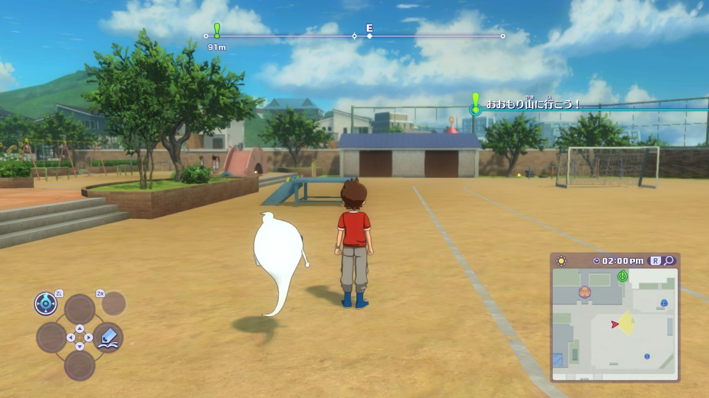
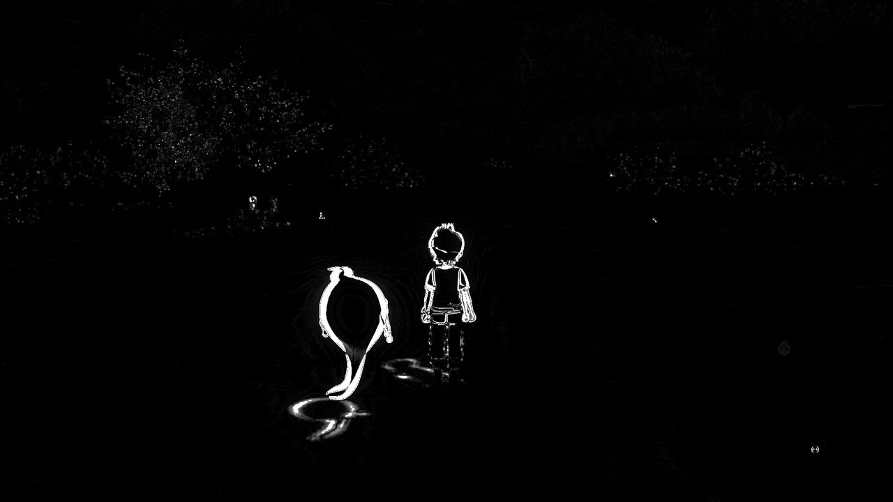

<h1 align="center">YW4 Recomp</h1>

  A fan static recompilation of <b>Yo-kai Watch 4++</b> (Nintendo Switch, update 2.2.0) into a native application, in the style of <a href="https://github.com/N64Recomp/N64Recomp">N64Recomp</a>.

  
  
  
  

  
   
  The title screen, recompiled and running natively on Windows (Vulkan, 30 frames/s).

> [!IMPORTANT]
> **Built with AI.** Claude (Anthropic's model, used through Claude Code) wrote most of this repository: the
> recompiler, the runtime, the reverse engineering notes and these docs. A human decides what to work on, plays and
> tests every build, compares it against the real game and reviews the changes. It is a personal fan project that
> happens to be public. If AI-written code is not something you want to use or read, feel free to pass on it; if you
> do run it, that is your call.

> [!NOTE]
> Platforms:
> - Windows - x86-64, Vulkan graphics backend (this is what is built and tested)
> - Linux - x86-64, Vulkan: planned; the runtime is written to be portable but has not been tested yet

> [!NOTE]
> **Bring your own game.** The repository holds tools, runtime code and patches, nothing from the game itself. To use
> it you need the ExeFS and RomFS of your own *Yo-kai Watch 4++* at update **2.2.0**, the last 4++ release; the tools
> check the exact build by hash and stop on anything else. Getting those files is up to you and is not covered here.
> The recompiled C code is produced on your machine from your copy and stays there.

## Status

Early, but playable. The game runs from boot through a new game: logos, title menu, name entry, the opening
cutscenes with dialogue, free movement in the Amano house and town, the Yo-kai Pad menus, the diary and autosave, at
a locked 30 frames/s. Expect missing effects and crashes in places nobody has reached yet.

- How it got here, step by step: [docs/progress.md](docs/progress.md)
- What is known to be missing or wrong: [docs/known-issues.md](docs/known-issues.md)

## How it works

- **Translated ahead of time, not interpreted.** Every ARM64 function in the game's `main` and `sdk` modules (73,844
  functions) becomes C before the game runs ([recomp/](recomp/README.md)); Clang compiles it into one native program.
- A native runtime ([runtime/](runtime/)) stands in for the Switch: the kernel (threads, memory, synchronisation),
  system services (filesystem with your RomFS read in place, input, audio, time, saves, applets) and the NVN graphics
  API on top of Vulkan.
- The game's own shaders are translated from the NV_gpu_program5 assembly they ship with into GLSL and SPIR-V
  ([decision 0020](docs/decisions/0020-shaders-from-the-assembly.md)).
- No emulator code is linked ([decision 0005](docs/decisions/0005-phase1-runtime-strategy.md)). Each instruction form
  of the recompiler is checked against a real ARM64 CPU (a Raspberry Pi 5).
- Why things are built this way is written down in [docs/decisions/](docs/decisions/).

## Screenshots

All captured from the recompiled build on Windows.

| | |
|---|---|
|  |  |
| The Amano house kitchen | Opening scene |
|  |  |
| LEVEL-5 logo | Opening movie |

## Native shadow pass

Optional (`YW4_SHADOWS=native`): our own renderer draws the shadow casters the game would draw, from the game's
data, instead of replaying the game's draw calls one by one
([decision 0024](docs/decisions/0024-shadow-pass.md)). It covers static, cut-out, skinned and instanced casters,
including props fading in and out and wind-swayed plants; the game still draws the rest (a second kind of
character, a few others).

Same save and frame, the game's shadows against ours. The only differences are animation timing between the two
runs (Whisper's float, idle poses, leaves):

| The game's shadows | Our shadow pass |
|---|---|
|  |  |

Difference image (white: pixels that differ)

Cost per frame on a scripted walk through the town (average of 3 runs each, alternating, nothing else running;
RTX 4070 Laptop):

| Per frame | The game's shadows | Our shadow pass | Change |
|---|---|---|---|
| Game work, average | 10.9 ms | 10.3 ms | **−0.6 ms** |
| Game work, 95th percentile | 18.0 ms | 16.8 ms | **−1.2 ms** |
| GPU busy, average | 11.3 ms | 10.9 ms | −0.3 ms |
| Process CPU | 72.7% of a core | 71.3% of a core | −1.4 points |

## Building from source

Requirements: Python 3.11+, Git, Clang (or GCC), a GPU with Vulkan 1.3 and the Vulkan SDK; SDL3 is fetched
automatically on Windows. Full steps in [docs/setup.md](docs/setup.md).

1. Copy `config.example.toml` to `config.local.toml` and point it at your extracted ExeFS and RomFS.
2. Verify and decompress the game code: `python -m tools.yw4.ingest`.
3. Recompile and build: `python -m recomp.translate`, `python -m tools.yw4.shaders`, `python -m recomp.shader --check`,
   then `python -m recomp.build --run`.

Runtime options, capture keys, input replay and the frame-inspection tools are in
[docs/debugging.md](docs/debugging.md).

## Project layout

| Path | What |
|---|---|
| `recomp/` | AArch64 → C recompiler and the shader translator |
| `runtime/` | Native runtime: kernel, services, NVN on Vulkan |
| `tools/` | Python input pipeline and analysis tools |
| `tests/` | Tests on synthetic data (no game files) |
| `docs/` | Setup, debugging, progress, known issues, decision records, recon report, Eden baseline |
| `third_party/musl/` | musl 1.1.19's math functions (MIT) |
| `work/`, `build/` | Generated output from your own game files (gitignored, never committed) |

## Credits

- **[N64Recomp](https://github.com/N64Recomp/N64Recomp)** - the model this project follows: ship the tools, let
  every player recompile their own copy.
- **[LAS Recomp](https://github.com/peiikai/LASRecomp)** by peiikai - a static recompilation of *Link's Awakening*
  for Switch; its approach to the Switch SDK and its README layout inspired this project's.
- **[musl](https://musl.libc.org/)** - the math library (`third_party/musl`, MIT).
- **[SDL3](https://www.libsdl.org/)** and the **[Vulkan](https://www.vulkan.org/)** headers.
- **Eden** (a Switch emulator) - used only as a visual and performance reference; none of its code is used.
- **LEVEL-5** for Yo-kai Watch 4. This project is not affiliated with or endorsed by LEVEL-5 or Nintendo.
