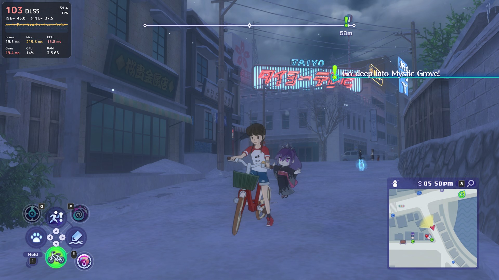
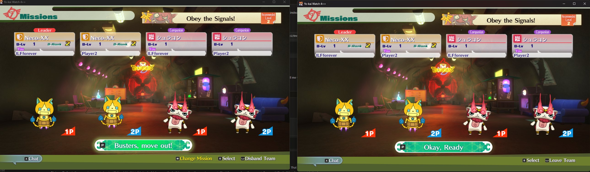
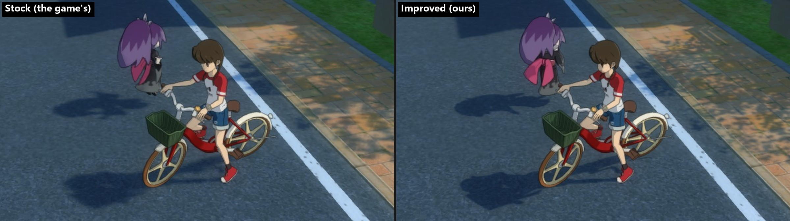
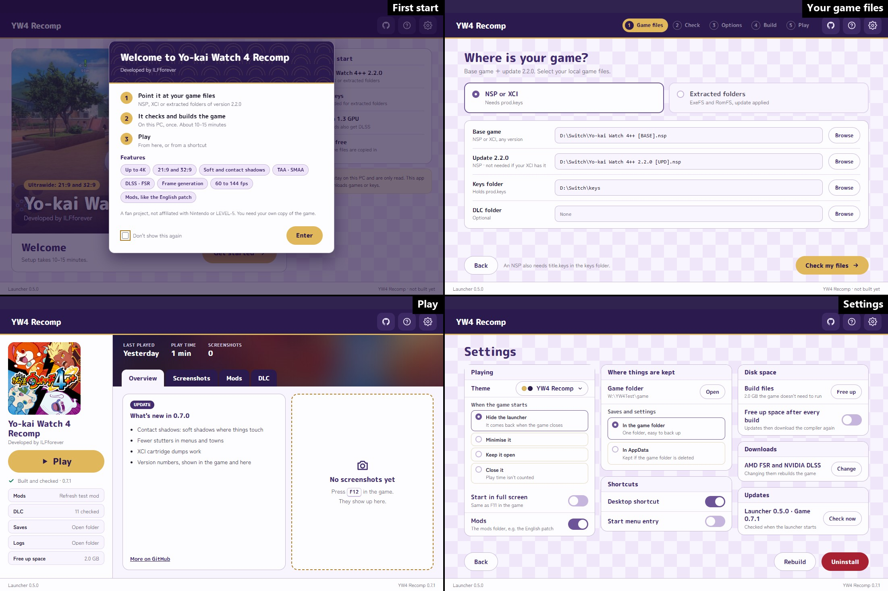

<h1 align="center">YW4 Recomp</h1>

  <b>Yo-kai Watch 4++, recompiled for PC.</b>
   
  4K · Ultrawide · DLSS and FSR · Frame generation · Online play · Mods and the English patch
   
  A fan static recompilation of the Nintendo Switch game (update 2.2.0), in the style of <a href="https://github.com/N64Recomp/N64Recomp">N64Recomp</a>: the game's code is translated into a native Windows and Linux program.

  
  
  
  

  <a href="https://github.com/ILFforever/YW4Recomp/releases/latest"><b>Download</b></a> ·
  <a href="https://ilfforever.github.io/YW4Recomp/"><b>Website</b></a> ·
  <a href="https://ilfforever.github.io/YW4Recomp/compare/">Comparisons</a> ·
  <a href="https://ilfforever.github.io/YW4Recomp/online/">Online play</a> ·
  <a href="https://ilfforever.github.io/YW4Recomp/changelog/">What's new</a>

  
   
  Ordinary Street at 4K: 103 frames a second on screen with DLSS frame generation, against the Switch's 30.

> [!IMPORTANT]
> **Built with AI.** Claude (Anthropic's model, used through Claude Code) wrote most of this repository: the
> recompiler, the runtime, the reverse engineering notes and these docs. A human decides what to work on, plays and
> tests every build, compares it against the real game and reviews the changes. It is a personal fan project that
> happens to be public. If AI-written code is not something you want to use or read, feel free to pass on it; if you
> do run it, that is your call.

> [!NOTE]
> **Bring your own game.** Nothing from the game is in this repository. You need files from your own copy of
> *Yo-kai Watch 4++* with the last update, **2.2.0**. Getting those files is up to you and is not covered here.

## Play it

**[Download the launcher](https://github.com/ILFforever/YW4Recomp/releases/latest)** (Windows installer or portable
zip, Linux AppImage). It checks your game files, builds the game on your PC once (10 to 15 minutes) and keeps it up
to date. [The launcher, step by step →](https://ilfforever.github.io/YW4Recomp/launcher/)

**Beta: playable, but not finished.** Tested from the start of a new game and on late-game saves (towns, the bamboo
forest, the Yo-kai World, battles); most of the story in between hasn't been played through yet. Found a bug? Use
**Report a bug** in the launcher or the game's overlay. [Known issues](docs/known-issues.md)

## Online play

The Switch plays online through Nintendo's servers, which a PC can't log in to. So the game's **Online** button
plays through **our own servers** in the US East and Singapore instead, with no account needed:

- **Ark Swap**: trade Yo-kai with a friend.
- **Blasters**: teams of up to four play missions together.
- Public rooms, or a private room code for friends only. The servers keep no IP addresses.

  

First built by [Quandiy](https://github.com/Quandiy) in their fork. [How to play online →](https://ilfforever.github.io/YW4Recomp/online/)

## Better than the Switch

An emulator plays the game's own graphics commands, so the game still decides its resolution, its shadows, its
16:9 screen and its 30 frames a second. Here the game's renderer is being replaced with our own, so those are ours
to change.

| | Switch | YW4 Recomp |
|---|---|---|
| Resolution | 1600×900 | up to 4K, menus and text kept sharp |
| Frame rate | 30 | 60, 120, 144 or no limit |
| Screen | 16:9 | 16:10, 21:9 and 32:9, the UI kept in the middle |
| Shadows | 1024 map, hard edges | up to 4096, soft shadows (PCSS), contact shadows |
| Anti-aliasing | none | FXAA, SMAA, TAA |
| Upscaling | none | NVIDIA DLSS, AMD FSR |
| Frame generation | none | NVIDIA DLSS, AMD FSR |
| Texture filtering | none | anisotropic, up to ×16 |
| Draw distance | lamps and signs pop in close | up to 10 times farther |

The same street, the game's shadows against ours:

21:9 at 4K height, from play:

**[See every feature with before/after sliders →](https://ilfforever.github.io/YW4Recomp/compare/)**

## Lighter than an emulator

Both on the same PC with the same save, at the game's own settings (1600×900, 30 frames a second), so they do the
same work ([docs/baseline.md](docs/baseline.md)):

| | Emulator (Eden) | YW4 Recomp |
|---|---|---|
| CPU, busy area | 204% of one core | **96%** |
| Memory | 6.8 GB | **3.2 GB** |
| Budget laptop (Ryzen 5 7530U, integrated graphics) | 22-30 frames/s | **35-40 frames/s** |

On Linux, a tester plays at about 110-120 frames a second on an AMD RX 6600 XT.
[More showcases and videos →](https://ilfforever.github.io/YW4Recomp/showcases/)

## Made for PC

- **Keyboard, mouse and controllers**: rebind everything; the mouse turns the camera and clicks through menus;
  Xbox, PlayStation and Joy-Con button icons; rumble.
- **In-game overlay** (Escape): every setting while you play, with a live preview, a performance HUD and themes.
- **Mods**: the English translation patch and other Switch mods, laid over your game without touching your files.
  The **YKW Mod Merger™** makes mods that change the same file work together.
- **The launcher**: game files, builds, updates, mods, DLC, saves and screenshots in one place.
- **Extras**: five Diary save slots, a shortcut wheel, cheats (unlimited Crank-a-kai and coins), Discord status.

  

[Controls →](https://ilfforever.github.io/YW4Recomp/controls/) ·
[The overlay →](https://ilfforever.github.io/YW4Recomp/overlay/) ·
[Mods →](https://ilfforever.github.io/YW4Recomp/mods/) ·
[Extras →](https://ilfforever.github.io/YW4Recomp/extras/)

## How it works

- **Translated ahead of time, not emulated.** All 73,844 ARM64 functions of the game's code become C before the
  game runs ([recomp/](recomp/README.md)), compiled into one native program.
- **A native runtime** ([runtime/](runtime/)) stands in for the Switch: threads, memory, files, input, audio, saves,
  and the Switch's graphics API (NVN) on Vulkan.
- **The game's own shaders** are translated from the GPU assembly they ship with
  ([decision 0020](docs/decisions/0020-shaders-from-the-assembly.md)).
- **No emulator code.** Each instruction the recompiler handles is checked against a real ARM64 CPU (a Raspberry
  Pi 5). Every design choice is written down in [docs/decisions/](docs/decisions/).

To build it yourself: [building from source](https://ilfforever.github.io/YW4Recomp/building/) (Windows and Linux),
or [docs/setup.md](docs/setup.md).

## Credits

- **[N64Recomp](https://github.com/N64Recomp/N64Recomp)**: the model this project follows: ship the tools, let
  every player recompile their own copy.
- **[LAS Recomp](https://github.com/peiikai/LASRecomp)** by peiikai: a static recompilation of *Link's Awakening*
  for Switch; its approach to the Switch SDK and its README layout inspired this project's.
- **[Quandiy](https://github.com/Quandiy)**: online play, first built in their fork.
- **[musl](https://musl.libc.org/)**: the math library (`third_party/musl`, MIT).
- **[SMAA](https://github.com/iryoku/smaa)** by Jorge Jimenez et al.: the SMAA shader and lookup textures (`third_party/smaa`, MIT).
- **[xplane-fsr3](https://github.com/JonathanOrr/xplane-fsr3)** by Jonathan Orr: the Linux port of AMD's FidelityFX
  SDK that FSR on Linux is built with (`third_party/fsr3-linux`, MIT).
- **[SDL3](https://www.libsdl.org/)** and the **[Vulkan](https://www.vulkan.org/)** headers.
- **Eden** (a Switch emulator): used only as a visual and performance reference; none of its code is used.
- **LEVEL-5** for Yo-kai Watch 4. This project is not affiliated with or endorsed by LEVEL-5 or Nintendo.

## Support

YW4 Recomp is free and for the community. If you enjoy it, a coffee is always appreciated.

## License

[MIT](LICENSE), for the code and docs in this repository only: not the game, its files, or anything built from
your copy of it. Third-party code keeps its own license (each folder in `third_party/` says which).
