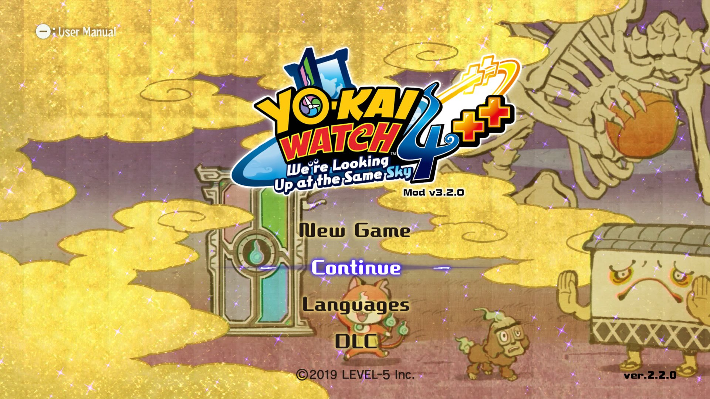
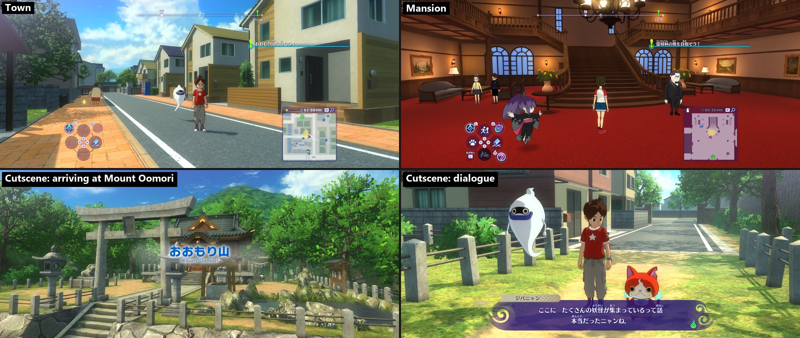

<h1 align="center">YW4 Recomp</h1>

<p align="center">
  <b>Yo-kai Watch 4++, recompiled for PC.</b>
  <br>
  4K · Ultrawide · DLSS and FSR · Frame generation · Online play · Mods and the English patch
  <br>
  <sub>A fan static recompilation of the Nintendo Switch game (update 2.2.0), in the style of <a href="https://github.com/N64Recomp/N64Recomp">N64Recomp</a>: the game's code is translated into a native Windows and Linux program.</sub>
</p>

<p align="center">
  
  
  
  <a href="https://buymeacoffee.com/ilfforever"></a>
</p>

<p align="center">
  <a href="https://github.com/ILFforever/YW4Recomp/releases/latest"><b>Download</b></a> ·
  <a href="https://ilfforever.github.io/YW4Recomp/"><b>Website</b></a> ·
  <a href="https://ilfforever.github.io/YW4Recomp/compare/">Comparisons</a> ·
  <a href="https://ilfforever.github.io/YW4Recomp/online/">Online play</a> ·
  <a href="https://ilfforever.github.io/YW4Recomp/changelog/">What's new</a>
</p>

<p align="center">
  
  <br>
  <sub>The title screen with the English patch, recompiled and running natively on Windows.</sub>
</p>

> [!IMPORTANT]
> **Built with AI.** Claude (Anthropic's model, used through Claude Code) wrote most of this repository: the
> recompiler, the runtime, the reverse engineering notes and these docs. A human decides what to work on, plays and
> tests every build, compares it against the real game and reviews the changes. It is a personal fan project that
> happens to be public. If AI-written code is not something you want to use or read, feel free to pass on it; if you
> do run it, that is your call.

> [!NOTE]
> **Bring your own game.** Nothing from the game is in this repository. You need files from your own copy of
> *Yo-kai Watch 4++* with the last update, **2.2.0**. Getting those files is up to you and is not covered here.

> [!NOTE]
> Platforms:
> - Windows - x86-64, Vulkan graphics backend (this is what is built and tested): NVIDIA RTX, and AMD Radeon
>   ([decision 0059](docs/decisions/0059-amd-depth-format-fallback.md)): a Ryzen 5 7530U laptop's integrated graphics
>   runs it at about 35-40 frames/s at native resolution, where the Eden emulator gets 22-30
> - Linux - x86-64, Vulkan: works. Tester [ouni666](https://github.com/ouni666) plays it on AOSC OS (KDE Plasma, Wayland) with an AMD RX 6600 XT at
>   about 110-120 frames/s, the GPU at full load, with sound and controls working. The launcher runs on Linux too, as
>   an AppImage ([decision 0071](docs/decisions/0071-linux-launcher.md)). FSR and DLSS upscaling and FSR frame
>   generation are built for Linux ([decision 0073](docs/decisions/0073-dlss-fsr-on-linux.md)), not yet tried on a real
>   Linux GPU; DLSS frame generation and Reflex are Windows only

## Play it

**[Download the launcher](https://github.com/ILFforever/YW4Recomp/releases/latest)** (Windows installer or portable
zip, Linux AppImage). It checks your game files, builds the game on your PC once (10 to 15 minutes) and keeps it up
to date. [The launcher, step by step →](https://ilfforever.github.io/YW4Recomp/launcher/)

**Beta: playable, but not finished.** Tested from the start of a new game and on late-game saves (towns, the bamboo
forest, the Yo-kai World, battles); most of the story in between hasn't been played through yet. Found a bug? Use
**Report a bug** in the launcher or the game's overlay. [Known issues](docs/known-issues.md)

### If you see graphical glitches

If something looks wrong, like broken or flickering shadows, change the game's renderer setting:

1. Open the overlay with **Escape**, then go to **Settings** and open **Advanced**.
2. Set **Shadow pass** from **Custom** to **Game**.

This makes the game draw the shadows with its own renderer instead of ours. It **will lower performance**, so
expect a lower frame rate. If the glitch is still there, try **G-BUFFER** the same way. Set the options back to
CUSTOM if the game runs too slowly.

## Better than the Switch

An emulator plays the game's own graphics commands, so the game still decides its resolution, its shadows, its
16:9 screen and its 30 frames a second. Here the game's renderer is being replaced with our own, so those are ours
to change.

| | Switch | YW4 Recomp |
|---|---|---|
| Resolution | 1600×900 | up to 4K, menus and text kept sharp |
| Frame rate | 30 | 60, 120, 144 or no limit |
| Screen | 16:9 | 16:10, 21:9 and 32:9, the UI kept in the middle |
| Shadows | 1024 map, hard edges | up to 4096, soft shadows (PCSS), contact shadows |
| Anti-aliasing | none | FXAA, SMAA, TAA |
| Upscaling | none | NVIDIA DLSS, AMD FSR |
| Frame generation | none | NVIDIA DLSS, AMD FSR |
| Texture filtering | none | anisotropic, up to ×16 |
| Draw distance | lamps and signs pop in close | up to 10 times farther |

The same street, the game's shadows against ours:


21:9 at 4K height, from play:



**[See every feature with before/after sliders →](https://ilfforever.github.io/YW4Recomp/compare/)**

## Lighter than an emulator

Both on the same PC with the same save, at the game's own settings (1600×900, 30 frames a second), so they do the
same work ([docs/baseline.md](docs/baseline.md)):

| | Emulator (Eden) | YW4 Recomp |
|---|---|---|
| CPU, busy area | 204% of one core | **96%** |
| Memory | 6.8 GB | **3.2 GB** |
| Budget laptop (Ryzen 5 7530U, integrated graphics) | 22-30 frames/s | **35-40 frames/s** |

<p align="center">
  
  <br>
  <sub>Ordinary Street at 4K: 103 frames a second on screen with DLSS frame generation, against the Switch's 30.</sub>
</p>

[More showcases and videos →](https://ilfforever.github.io/YW4Recomp/showcases/)

## Online play

The Switch plays online through Nintendo's servers, which a PC can't log in to. So the game's **Online** button
plays through **our own servers** in the US East and Singapore instead, with no account needed:

- **Ark Swap**: trade Yo-kai with a friend.
- **Blasters**: teams of up to four play missions together.
- Public rooms, or a private room code for friends only. The servers keep no IP addresses.

<p align="center">
  
</p>

First built by [Quandiy](https://github.com/Quandiy) in their fork. [How to play online →](https://ilfforever.github.io/YW4Recomp/online/)

## Made for PC

- **Keyboard, mouse and controllers**: rebind everything; the mouse turns the camera and clicks through menus;
  Xbox, PlayStation and Joy-Con button icons; rumble.
- **In-game overlay** (Escape): every setting while you play, with a live preview, a performance HUD and themes.
- **Mods**: the English translation patch and other Switch mods, laid over your game without touching your files.
  The **YKW Mod Merger™** makes mods that change the same file work together.
- **The launcher**: game files, builds, updates, mods, DLC, saves and screenshots in one place.
- **Extras**: five Diary save slots, a shortcut wheel, cheats (unlimited Crank-a-kai and coins), Discord status.

<p align="center">
  
</p>

[Controls →](https://ilfforever.github.io/YW4Recomp/controls/) ·
[The overlay →](https://ilfforever.github.io/YW4Recomp/overlay/) ·
[Mods →](https://ilfforever.github.io/YW4Recomp/mods/) ·
[Extras →](https://ilfforever.github.io/YW4Recomp/extras/)

## Goals

<details>
<summary><b>Planned</b> (4)</summary>

| Goal | What it will be |
|---|---|
| **More cheats** | More switches on the overlay's Cheats page, next to unlimited Crank-a-kai and unlimited coins |
| **Easier Soultimates on the keyboard** | A little leeway for the two keys pressed together (Q + E by default), so it works whichever of them goes down first |
| **Enemy-only target switch** | A key that cycles through the enemies alone in battles; the game has Tab for allies and Left / Right for everyone ([#18](https://github.com/ILFforever/YW4Recomp/issues/18)) |
| **Yo-kai Arks** | Ark Scan on PC: the Switch reads the Ark toys over NFC, so the game gets a virtual Ark instead (or a USB NFC reader for real ones) |

</details>

<details>
<summary><b>Ongoing</b> (7)</summary>

| Goal | Where it stands |
|---|---|
| **Performance (CPU)** | Less work per frame on the CPU, so busy places hold their frame rate on slower PCs: the renderer's GPU commands are being made cheaper to build (in testing) |
| **Our own renderer** | Ours: shadows, surfaces, bloom, distance blur, lighting, sky, tone mapping. **Left:** choosing what to draw, two screen passes, the UI and menus |
| **Steadier shadows** | Shadows still shimmer a little as the camera moves; steadier cascades next |
| **Shadows on AMD graphics cards** | Our shadow mask still draws streaks on some AMD cards as the camera turns ([#8](https://github.com/ILFforever/YW4Recomp/issues/8)); a fix tried in 1.6.0 didn't cure it, and it doesn't happen on NVIDIA. Next: testing on an AMD card. Until then, Shadow mask → Game avoids it |
| **Better anti-aliasing** | FXAA, SMAA and TAA (steady thin edges: fences, nets, leaves) on the 3D scene before the UI is drawn, so text stays crisp; per-object motion for TAA next (a first version is in, off by default) |
| **Clean moving characters with frame generation** | DLSS's red trail behind characters in the rain is gone with the new DLSS MODEL: HIGH QUALITY setting. Still open: with frame generation on (DLSS or FSR), a fine noisy outline around characters while the camera turns |
| **Mouse in the game's menus** | Pointing, clicking and wheel scrolling work on the Yo-kai Pad and the pages opened from it, such as the item and quest lists, Ukiukipedia and Members ([decision 0057](docs/decisions/0057-mouse-menu-lists.md)). Clicks and the wheel also work on the title screen, in conversations and shops, on the map, in the battle's Stopwatching menu and on Naviwoof Guide (see [Keyboard, mouse and controllers](#features)). Some Pad pages still had open issues on 2026-11-08 (Watch skills, Soulmate, Trophies, Treasure photos, Switch moves) |

</details>

<details>
<summary><b>Finished</b> (21)</summary>

| Goal | Where it stands |
|---|---|
| **Performance** | The game's 30 frames/s everywhere tested, and well above it with the FRAME RATE setting (60, 120, 144 or no limit) |
| **Higher frame rates** | 30, 60, 120, 144, VSYNC or no limit, switchable while playing (FRAME RATE in the panel; VSYNC after a restart): the game already moves by the real time between frames, so walking, battles, menus and cutscenes all work (~140 frames/s at 1600×900). At 4K the GPU is the limit; upscaling lifts it, frame generation doubles what is shown |
| **Sharper distance** | Anisotropic texture filtering and a softer distance blur: distant ground, roads and buildings stay sharp without 4K |
| **Better shadows** | Bigger shadow maps (up to 4096), PCSS soft shadows and contact shadows ([decisions 0025](docs/decisions/0025-pcss-soft-shadows.md), [0045](docs/decisions/0045-contact-shadows.md)) |
| **Higher resolution** | The 3D view at 1080p, 1440p or 4K instead of the game's 1600×900 (30 frames/s at 4K on an RTX 4070 laptop) |
| **Ultrawide and other aspect ratios** | 16:10, 21:9 and 32:9 in the panel: a wider view of the world with the UI kept 16:9 in the middle; exploring, battles and cutscenes work; dialog dimming and the loading screen cover the full width |
| **Upscaling (NVIDIA DLSS, AMD FSR)** | The world drawn smaller and rebuilt at full size, menus and text kept full size. **DLSS for the cleanest picture (NVIDIA RTX), FSR for the most frames (any GPU).** At 4K 21:9 on an RTX 4070 laptop, instead of ~81 frames/s with TAA: DLSS ~85 / ~92 / ~82 (quality / balanced / performance), FSR ~94 / ~106 / ~118. DLSS keeps fine patterns (far nets, perforated fences) clean where FSR gets grainy ([decisions 0039](docs/decisions/0039-fsr-upscaling.md), [0040](docs/decisions/0040-dlss-upscaling.md)) |
| **Frame generation (NVIDIA DLSS, AMD FSR)** | A frame made between each two of the game's: about twice as many on screen, the menus kept still. **On RTX 40 and newer use DLSS**: more game frames left and cleaner moving characters. In a busy town at 4K 21:9 on an RTX 4070 laptop, instead of ~70 frames/s: DLSS ~150 shown (~75 game), FSR ~126 shown (~63 game, any GPU). NVIDIA Reflex in the panel too ([decision 0041](docs/decisions/0041-frame-generation.md)) |
| **Keyboard, mouse and controllers** | Bindings on the panel's CONTROLS page, saved, with separate keys for battles and your controller's own button names; tested with a DualSense. Controller rumble and haptics, on by default, with an on/off switch on the overlay's Controls page ([decision 0058](docs/decisions/0058-controller-rumble.md)). On-screen button icons follow what you play with and your bindings (keyboard, Xbox, PlayStation or Nintendo, [decision 0042](docs/decisions/0042-button-icons-and-mouse.md)). The mouse turns the camera through the game's own unused mouse code |
| **Mod support** | Mods in the Switch's layout are laid over your game files at start, as on a modded Switch, without touching your dump: the English translation patch runs (see [Features](#features), [decision 0043](docs/decisions/0043-mods-layeredfs.md)). The YKW Mod Merger™ makes mods that change the same file work together ([0067](docs/decisions/0067-mods-merge-cpk-list.md), [0068](docs/decisions/0068-mods-merge-data-files.md)) |
| **Playing together online** | Ark Swap trades and Blasters missions with friends over the internet through two servers of ours (US East, Singapore), with Public or Private room codes; no IP addresses kept ([decision 0082](docs/decisions/0082-online-play-over-ldn.md), [the site](https://ilfforever.github.io/YW4Recomp/online/)) |
| **In-game overlay** | Escape or a controller button pauses the game and opens a side panel: settings, controls, the performance HUD's options, screenshots and exit, drawn like its design ([decision 0053](docs/decisions/0053-in-game-overlay.md)); Preview shows graphics changes live, and themes match the launcher's ([decision 0055](docs/decisions/0055-overlay-themes.md)) |
| **Launcher** | A Windows app that takes your game files, checks them, builds the game and starts it, with mods, DLC, saves and screenshots in one place. Installer and portable zip ([decision 0052](docs/decisions/0052-launcher-packaging.md)), tested on a second PC. Released with 1.0.0 (2026-11-13): [download](https://github.com/ILFforever/YW4Recomp/releases/latest) |
| **Linux** | Tester [ouni666](https://github.com/ouni666) plays it on AOSC OS with an AMD RX 6600 XT at about 110-120 frames/s, sound and controls included (2026-11-13). DLSS and FSR upscaling and FSR frame generation are built on Linux too ([decision 0073](docs/decisions/0073-dlss-fsr-on-linux.md)); DLSS frame generation and Reflex are Windows only |
| **Launcher for Linux** | The same launcher as an AppImage, from launcher 1.2.0 (2026-11-15), so the game no longer has to be built by hand on Linux ([decision 0071](docs/decisions/0071-linux-launcher.md)). Players use it on their Linux desktops |
| **Built-in cheats** | A Cheats page in the overlay, switched while playing: unlimited Crank-a-kai and unlimited coins so far, with a switch in the launcher ([decision 0074](docs/decisions/0074-cheats.md)) |
| **Diary save slots** | Five save slots stacked in the Diary like the game's own rows, with one Autosave under them; pick a slot for a new game, Left / Right on the in-game Save screen, X to delete ([decision 0078](docs/decisions/0078-diary-save-slots.md)) |
| **Shortcut wheel** | Hold L's key (1) while exploring and all eight field shortcuts appear in a wheel you point at with the mouse ([decision 0075](docs/decisions/0075-shortcut-wheel.md)) |
| **Image sharpening** | A Sharpening slider after every anti-aliasing and upscaling choice, Off to Max ([decision 0076](docs/decisions/0076-sharpening.md), [#11](https://github.com/ILFforever/YW4Recomp/issues/11)) |
| **Running modes** | Default, Always, Toggle or Hold, with a Run key (Left Shift, the left stick press), so you don't have to hold B to run ([decision 0080](docs/decisions/0080-running-modes.md), [#18](https://github.com/ILFforever/YW4Recomp/issues/18)) |
| **Discord status** | Your Discord profile shows where you are (the main menu, the street or place, a battle), your Watch Rank and the time played; on unless you switch it off ([decision 0077](docs/decisions/0077-discord-rich-presence.md)). Since 1.7.0 |

</details>

## How it works

- **Translated ahead of time, not emulated.** All 73,844 ARM64 functions of the game's code become C before the
  game runs ([recomp/](recomp/README.md)), compiled into one native program.
- **A native runtime** ([runtime/](runtime/)) stands in for the Switch: threads, memory, files, input, audio, saves,
  and the Switch's graphics API (NVN) on Vulkan.
- **The game's own shaders** are translated from the GPU assembly they ship with
  ([decision 0020](docs/decisions/0020-shaders-from-the-assembly.md)).
- **No emulator code.** Each instruction the recompiler handles is checked against a real ARM64 CPU (a Raspberry
  Pi 5). Every design choice is written down in [docs/decisions/](docs/decisions/).

## Building from source

Requirements: Python 3.11+, Git, a C compiler (Clang 19 or newer recommended:
[llvm-mingw](https://github.com/mstorsjo/llvm-mingw) on Windows; GCC 15 or newer also works), a GPU with Vulkan 1.3, and
`glslangValidator` (from the [Vulkan SDK](https://vulkan.lunarg.com/), or a standalone glslang). SDL3 is fetched
automatically on Windows. Full steps in [docs/setup.md](docs/setup.md), and step by step for Windows and Linux on
[the build page](https://ilfforever.github.io/YW4Recomp/building/).

Disk space: an install takes about 11.3 GB, or 9.3 GB after "Free up space". Building from an NSP or XCI peaks near
20.7 GB; from extracted folders, about 11.4 GB ([disk usage](docs/disk-usage.md)).

1. If you will commit: install the guard that keeps game data out of commits, `python -m tools.yw4.guard --install`.
2. Copy `config.example.toml` to `config.local.toml`. Point `exefs_dir` and `romfs_dir` at your extracted ExeFS and
   RomFS; set `[tools] cc` to your Clang (the default is gcc) and `[tools] glslang` if it isn't on your PATH.
3. Check the config: `python tools/yw4/config.py` prints the resolved paths or says what is missing.
4. Verify and decompress the game code: `python -m tools.yw4.ingest`.
5. Recompile and build: `python -m recomp.translate`, `python -m tools.yw4.shaders`, `python -m recomp.shader --check`,
   then `python -m recomp.build --run`.

Runtime options are environment variables, for example `YW4_SHADOW_RES=1024`: in PowerShell
`$env:YW4_SHADOW_RES = "1024"`, in cmd `set YW4_SHADOW_RES=1024`, before starting the game.

Runtime options, capture keys, input replay and the frame-inspection tools are in
[docs/debugging.md](docs/debugging.md). Every run writes its log to `work/logs/`: it names the GPU and driver in use,
and is the file to send with a bug report.

### Building on Linux

The same steps as above, with the tools from your distribution: Clang 19+ (or GCC 15+), Python 3.11+, Git,
pkg-config, glslang and SDL3 with its headers, plus a Vulkan driver (Mesa or NVIDIA's).

```
sudo pacman -S clang python git pkgconf glslang sdl3                        # Arch
sudo dnf install clang python3 git pkgconf glslang SDL3-devel               # Fedora
sudo apt install clang python3 git pkg-config glslang-tools libsdl3-dev     # Debian 13, Ubuntu 25.04+
```

No compiler or glslang, or a system you can't install on (Bazzite, SteamOS)? `python3 -m tools.yw4.system` downloads
them and prints the two `[tools]` lines to add to your config.

Set `[tools] cc = "clang"` in `config.local.toml`, then build as in steps 1-5. After that, start the game with
`./work/build/yw4` alone: the build writes your game and DLC folders into `work/build/game.ini`. Saves go to
`~/.local/share/YW4Recomp/save`. Ubuntu 24.04 has no SDL3 package: see
[docs/setup.md](docs/setup.md#requirements). AMD FSR and NVIDIA DLSS upscaling are built on Linux too (FSR from
AMD's own source, during the build: about a minute), and so is FSR frame generation; DLSS frame generation and
Reflex are Windows only. Or skip all this: the launcher's Linux AppImage does these steps for you.

## Project layout

| Path | What |
|---|---|
| `recomp/` | AArch64 → C recompiler and the shader translator |
| `runtime/` | Native runtime: kernel, services, NVN on Vulkan |
| `tools/` | Python input pipeline and analysis tools |
| `tests/` | Tests on synthetic data (no game files) |
| `docs/` | Setup, debugging, graphics options, progress, known issues, decision records, recon report, Eden baseline |
| `third_party/musl/` | musl 1.1.19's math functions (MIT) |
| `third_party/smaa/` | SMAA's shader and lookup textures (MIT) |
| `work/`, `build/` | Generated output from your own game files (gitignored, never committed) |

## Credits

- **[N64Recomp](https://github.com/N64Recomp/N64Recomp)**: the model this project follows: ship the tools, let
  every player recompile their own copy.
- **[LAS Recomp](https://github.com/peiikai/LASRecomp)** by peiikai: a static recompilation of *Link's Awakening*
  for Switch; its approach to the Switch SDK and its README layout inspired this project's.
- **[Quandiy](https://github.com/Quandiy)**: online play, first built in their fork.
- **[musl](https://musl.libc.org/)**: the math library (`third_party/musl`, MIT).
- **[SMAA](https://github.com/iryoku/smaa)** by Jorge Jimenez et al.: the SMAA shader and lookup textures (`third_party/smaa`, MIT).
- **[xplane-fsr3](https://github.com/JonathanOrr/xplane-fsr3)** by Jonathan Orr: the Linux port of AMD's FidelityFX
  SDK that FSR on Linux is built with (`third_party/fsr3-linux`, MIT).
- **[SDL3](https://www.libsdl.org/)** and the **[Vulkan](https://www.vulkan.org/)** headers.
- **Eden** (a Switch emulator): used only as a visual and performance reference; none of its code is used.
- **LEVEL-5** for Yo-kai Watch 4. This project is not affiliated with or endorsed by LEVEL-5 or Nintendo.

## Support

YW4 Recomp is free and for the community. If you enjoy it, a coffee is always appreciated.

[](https://buymeacoffee.com/ilfforever)

## License

[MIT](LICENSE), for the code and docs in this repository only: not the game, its files, or anything built from
your copy of it. Third-party code keeps its own license (each folder in `third_party/` says which).
