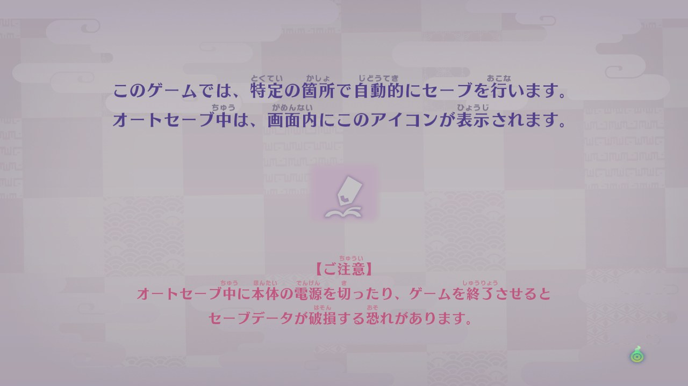
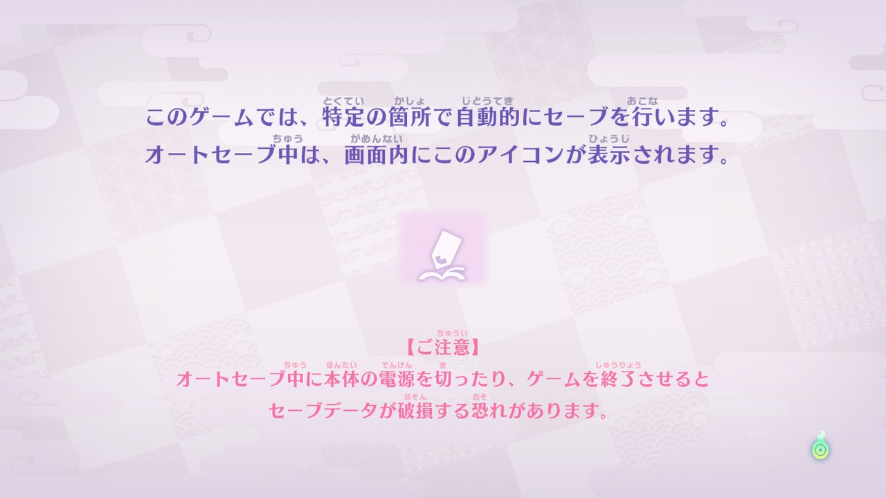

<h1 align="center">YW4 Recomp</h1>

<p align="center">
  A fan static recompilation of <b>Yo-kai Watch 4++</b> (Nintendo Switch, update 2.2.0) that runs natively on Windows and Linux, in the style of <a href="https://github.com/N64Recomp/N64Recomp">N64Recomp</a>.
</p>

<p align="center">
  
  
  
  
</p>

<p align="center">
  
  <br>
  <sub>The title screen, recompiled and running natively on Windows (Vulkan, 30 frames/s).</sub>
</p>

> [!IMPORTANT]
> This repo contains only tools, runtime code, and patches. It contains **no game data** and no recompiler output. Provide your own dump of the final 4++ update (2.2.0).

**What it is:** every ARM64 function in the game's `main` and `sdk` modules is translated to C ahead of time, compiled with Clang, and linked against a native runtime that stands in for the Switch's kernel, system services and NVN graphics (on Vulkan). No emulator code is linked. The game's own shaders are translated from the assembly they ship with.

**Status:** Phase 3 (kernel and system services). The game boots through its splash screens and opening movie to the title menu. See [Progress](#progress) below.

## Screenshots

All captured from the recompiled build on Windows (`YW4_SCREENSHOTS`, see [Setup](#setup)).

| | |
|---|---|
|  |  |
| Copyright warning | LEVEL-5 logo |
|  |  |
| Autosave notice (waits for A) | Opening movie |

## Setup

Requirements: Python 3.11+, Git, and a C11 compiler for the recompiler tests: Clang preferred ([llvm-mingw](https://github.com/mstorsjo/llvm-mingw) on Windows; set `[tools] cc`), GCC works too. The host CPU needs FMA3 (any x86-64 CPU since 2013). CMake comes later.

0. Install the game-data guard as a pre-commit hook: `python -m tools.yw4.guard --install`.
1. Copy `config.example.toml` to `config.local.toml`.
2. Fill in `exefs_dir` and `romfs_dir` with the folders of your already-extracted ExeFS and RomFS.
   If you have your base and update NSPs instead, also set `base_nsp`, `update_nsp`, `hactool_exe`
   ([hactool](https://github.com/SciresM/hactool) 1.4.0) and `keys_dir` (your console's `prod.keys` and
   `title.keys`), point `exefs_dir`/`romfs_dir` at empty folders, and run `python -m tools.yw4.extract`.
3. Keep `work_dir` outside any cloud-synced folder.
4. Check it:

   ```
   python tools/yw4/config.py
   ```

   It prints the resolved paths, or a clear error saying what is missing.

5. Decompress and verify the ExeFS modules:

   ```
   python -m tools.yw4.ingest
   ```

   It refuses to continue unless `main` matches the build pinned in `target.toml`. Outputs go to `<work_dir>/exefs/`.

6. Measure the binary and assets (tables go to `<work_dir>/recon/`, summary in `docs/recon.md`):

   ```
   python -m tools.yw4.recon
   ```

Tests (synthetic data only): `python -m unittest discover -s tests -t .`

The runtime's window needs SDL3: `recomp.build` fetches it on Windows (`python -m tools.yw4.deps`, pinned and hash-checked); on Linux install it (`pkg-config sdl3`). F12 saves a screenshot to `<work_dir>/screenshots/`.

7. Recompile `main` and `sdk` and run them (Phase 3; details in `recomp/README.md`):

   ```
   python -m recomp.translate      # both modules -> <work_dir>/recomp/ (C, never committed)
   python -m tools.yw4.shaders     # pull the game's shader assembly out -> <work_dir>/shaders/asm/
   python -m recomp.shader --check # translate to GLSL, compile to SPIR-V (needs [tools] glslang)
   python -m recomp.build --run    # build <work_dir>/build/yw4.exe and run it
   ```

   Run it from the repo root: shaders are looked up under `work/shaders/`. It opens a window and boots to the title menu.

### Run options

Environment variables read by the runtime; the most useful ones:

| Variable | What it does |
|---|---|
| `YW4_SCREENSHOTS=600,2500` | Save a screenshot at these frame numbers (also F12 at any time) |
| `YW4_SCREENSHOT_DIR=path` | Where screenshots go (default `<work_dir>/screenshots/`) |
| `YW4_INPUT=2400:1:10` | Scripted presses, `tick:buttons(hex):length`, comma separated; `1` is A. A at tick 2400 gets past the autosave notice |
| `YW4_PERF=0` | Turn off the performance log (on by default: `work/perf/perf_<time>.csv` per frame and a `.txt` summary: frame interval, game work, GPU busy/span from timestamp queries, CPU, memory; `YW4_PERF_DIR` moves it) |
| `YW4_LOG=0` | Turn off the log file (on by default: everything printed on stderr is also saved in `work/logs/yw4_<time>.log`; `YW4_LOG_DIR` moves it) |
| `YW4_HEADLESS=1` | No window, no Vulkan |
| `YW4_VULKAN_VALIDATION=1` | Turn on the Vulkan validation layer |

Tracing and probes (`YW4_TRACE_*`, `YW4_PROBE*`, `YW4_WATCH*`, `YW4_GPU_TRACE*`) are described where they are read in `runtime/src/`.

## Progress

Where the recompiled game stops right now, and how it got there. Newest first. Each step links to the decision record that explains it.

**Current state:** no stop through the name entry and into the opening scene (a 3D room, dialogue boxes; it waits for A). The game draws on Vulkan (0021) with its own shaders translated (0020): the copyright warning, the LEVEL-5 logo, the autosave notice (waits for A), the opening movie, and the title menu with its logo, all animated. Keyboard and gamepad reach the game; the owner's add-on content is listed. Known gaps: the "4++" logo variant (add-on ownership), the translation mod (LayeredFS, Phase 5), compute dispatches, alpha test, streaks in movies.

**Direction change (0014):** the `sdk` will be recompiled too, instead of re-implementing its 578 functions by hand; native code moves to the kernel/service level. Done: every instruction in `sdk` translates; both modules are translated, loaded and linked; real guest threads. NVN runs headless (0017: owner chose headless first, then SDL3 + Vulkan); next: input, then the services the frame loop needs.

| Date | Step | Result |
|---|---|---|
| 2026-10-22 | New game (0022): the keyboard applet answered natively; switch tables the recompiler missed (scheduling gaps, table base loaded after the branch); `time:u` clock snapshots; 32-bit integer vertex inputs | Name entry, the first 3D character, and the **opening scene with dialogue** render |
| 2026-10-21 | Recompiler fix: a function whose code includes a block placed below its entry now starts with a jump to the entry (5 functions; one is the engine's resource lookup by name hash, main+0xa7d8bc) | **Menus render**: every menu mesh had been skipped because its texture links were never found; the warning card, autosave notice and title menu now draw |
| 2026-10-21 | Draw path step 2 (0021): pipelines, descriptors, texture uploads, quads, window crop; the translated shaders run | **First real frames**: the LEVEL-5 logo and the autosave notice; waits there for a button (input next) |
| 2026-10-21 | Draw path step 1 (0021): the game's memory pools imported into Vulkan in place, an image per texture, clears and present on the GPU, NVN syncs on a timeline semaphore; shader keys checked at run time | 30 frames/s on the GPU path; all 33 shaders the game loads are translated; still black (draws next) |
| 2026-10-21 | Shader translator `recomp/shader.py`: NV_gpu_program5 → GLSL 4.60, registers as raw bits, one statement per instruction with the source as a comment, Vulkan binding scheme (0020) | All 1,349 programs translate and compile to SPIR-V (`--check` with glslang) |
| 2026-10-21 | Decision: translate shaders from their shipped NV_gpu_program5 assembly; `HBH1` container decoded; `tools/yw4/shaders.py` extracts them keyed by a hash of the text (0020) | 1,891 programs, 1,349 distinct, 58 opcodes, structured control flow; all texture handles come from fixed slots, so no bindless emulation |
| 2026-10-21 | The window: SDL3 (fetched, pinned) and Vulkan (headers vendored, loaded at run time); colour clears on the CPU; present reads the window texture back; screenshots (0019) | A window at 30 frames/s, black until draws exist; clears show a 1600×900 deferred G-buffer |
| 2026-10-21 | Precise timing on Windows (1 ms system timer, high-resolution sleeps; before, a 16.7 ms sleep took ~31 ms); presenting waits for the display's flip like the Switch does | 11 frames/s → a steady 30.0 frames/s |
| 2026-10-21 | Input (`hid`: shared memory, vibration), network (offline), time zone, audio (`audout` played in real time, `audren` device events), save data in host folders, `WriteTexels` for any region, address arbiter type 2; setjmp/longjmp for Lua's errors; a crash handler (0017, 0018) | The frame loop runs: 8,400 frames without a stop |
| 2026-10-21 | Headless NVN: the game's 177 NVN functions (objects, builders, state, command recording into the game's memory), Tegra texture layout; `nn::vi` overridden with a 60 Hz vsync thread; guest symbols for native code; host-signalled events; account, launch parameter, operation mode, language (0017) | NVN device and window set up; through display set-up to input (`hid`) |
| 2026-10-21 | Native overrides by symbol in the translator (`recomp/overrides.toml`); NVN entered at `nvnBootstrapLoader`, the sdk's GPU driver (`nv::InitializeGraphics`, `nvdrv`) skipped; `tools/yw4/where.py` names addresses (0016) | The game asks for its NVN functions and makes its first NVN call |
| 2026-10-21 | Guest threads as host threads: one kernel lock, blocking mutexes, condition variables, events, thread exit/join, address arbiter, cancel, a deadlock detector; transfer memory (0015) | 8 threads start and run in parallel; through to the first graphics service, `nvdrv` |
| 2026-10-21 | Clock service with shared memory; filesystem service with a virtual RomFS image of the owner's folder (tables built at start-up, file data read on demand, no copy); `MapMemory` (0014) | Through the constructors' clock and file set-up to the first `CreateThread` |
| 2026-10-21 | IPC: message codec (HIPC/CMIF, domains, control messages), service manager, first services (`appletOE`, `apm`, `lm`, `aoc:u`, `pctl`), kernel events, `svcBreak` with a guest backtrace, Horizon's three-region module layout in `QueryMemory` (0014) | Through the sdk's start-up and the game's `nninitStartup` into `main`'s constructors |
| 2026-10-21 | Minimal kernel: address-space layout, `GetInfo`, heap (`SetHeapSize`, reserved and committed as it grows), `QueryMemory`, thread properties, single-thread mutex/condition-variable calls, sleep, system tick (0014) | The sdk's start-up runs through 50 system calls to its first IPC |
| 2026-10-21 | Translate and load both modules: symbols resolved at translation time in load order, one dispatch over both, start-up through the sdk's own `nn::init::Start` (0014) | 73,844 functions; Nintendo's start-up code runs natively until its first system call |
| 2026-10-21 | Instructions the `sdk` needs: AES/SHA/PMULL crypto, SIMD integer (`addv`, `smlal`, `sqadd`...), CRC32, fused multiply-add, `MRS`/`MSR`, cache ops, `SVC` (0014) | All of `sdk` translates; 13 forms Pi-checked (120,000 cases), 3 planted bugs caught |
| 2026-10-21 | Decision: recompile `sdk` as well as `main`, measured first: 99.3% of its 33,616 functions already translate (0014) | Plan for the rest of Phase 3 |
| 2026-10-21 | Math library: musl 1.1.19's C (`third_party/musl`), checked against the sdk's own functions run on the Pi; sdk version-locked in `target.toml` (0013) | All 40 math functions match the Switch bit for bit on 800,000 inputs |
| 2026-10-21 | C library basics: memory, strings, ctype, integer parsing; `__cxa_guard_*`; `__nnmusl_init_dso` (0012) | The 830 constructors start running |
| 2026-10-21 | First native `sdk` functions: start-up memory (`nn::os`), logging and asserts (`nn::diag`), the game's heap (`nn::mem::StandardAllocator` on a TLSF allocator) (0011) | `nninitStartup` runs to the end; the game logs `Remain Memory Size 198MiB` |
| 2026-10-21 | Loader and import stubs (0010) | `main` loads at its Switch address `0x7100000000`, relocates, and runs natively until its first `sdk` call |
| 2026-10-21 | Every instruction in `main` translates (0006, 0007) | 40,228 functions, 4.25 M instructions, 0 untranslated; compiles and links with Clang |
| 2026-10-20 – 21 | Recompiler: integer, loads/stores, floating point and SIMD, atomics, whole functions (0006–0009) | Each instruction form checked against a real ARM64 CPU (Raspberry Pi 5, 0004) |
| 2026-10-20 | Phase 1 decision: custom runtime, recompile only `main`, NVN on Vulkan (0005) | |
| 2026-10-14 – 20 | Phase 0: scaffold, NSO pipeline with version lock, recon report, Ghidra setup (0001–0003) | `docs/recon.md` |

Still open from Phase 0: the baseline benchmark (`docs/baseline.md`), which needs the owner's emulator runs.

Known gaps, in the order they will come up:
- Graphics: compute dispatches, alpha test, streaks in movies, the "4++" logo variant (add-on ownership).
- The translation mod (LayeredFS, Phase 5).
- C++ exceptions are not supported: nothing in `main` throws (0012).

## Layout

| Path | What |
|---|---|
| `tools/` | Python analysis and input-pipeline scripts |
| `runtime/` | Native runtime (Phase 1+) |
| `recomp/` | AArch64 → C recompiler (Phase 2+) |
| `docs/` | Recon report, baseline, decision records, README screenshots |
| `third_party/musl/` | musl 1.1.19's math functions (MIT), see its README |
| `work/`, `build/` | Generated output (gitignored) |

See `docs/decisions/` for why things are set up this way.
