<h1 align="center">YW4 Recomp</h1>

  <b>Yo-kai Watch 4++, recompiled for PC.</b>
   
  4K · Ultrawide 21:9 / 32:9 · PCSS soft shadows · TAA / SMAA · ×16 texture filtering · Xbox, PlayStation and Joy-Cons
   
  A fan static recompilation of the Nintendo Switch game (update 2.2.0), in the style of <a href="https://github.com/N64Recomp/N64Recomp">N64Recomp</a>: the game's code is translated into a native Windows program.

  
  
  
  

  
   
  The title screen, recompiled and running natively on Windows (Vulkan, 30 frames/s).

> [!IMPORTANT]
> **Built with AI.** Claude (Anthropic's model, used through Claude Code) wrote most of this repository: the
> recompiler, the runtime, the reverse engineering notes and these docs. A human decides what to work on, plays and
> tests every build, compares it against the real game and reviews the changes. It is a personal fan project that
> happens to be public. If AI-written code is not something you want to use or read, feel free to pass on it; if you
> do run it, that is your call.

> [!NOTE]
> Platforms:
> - Windows - x86-64, Vulkan graphics backend (this is what is built and tested)
> - Linux - x86-64, Vulkan: planned; the runtime is written to be portable but has not been tested yet

> [!NOTE]
> **Bring your own game.** Nothing from the game is in this repository. You need files from your own copy of
> *Yo-kai Watch 4++* with the last update, **2.2.0**. Getting those files is up to you and is not covered here.
>

## Status

Work in progress: not playable from start to finish yet. What runs so far: from boot through the start of a new
game (logos, title menu, name entry, the opening cutscenes, the Amano house and town, the Yo-kai Pad menus, the
diary and autosave), and from late-game saves: towns at night, the bamboo forest, the Yo-kai World, and battles.
Most of the game has not been tried.

- **Frame rate**: the game's 30 frames/s, or 60, 120, 144 or no limit (FRAME RATE in the settings panel, F1). The game
  moves by real time, so walking and battles keep their speed at any rate; menus and cutscenes are still being
  checked. The game's own 30 holds everywhere tested.
- **Graphics**: up to 4K and ultrawide, sharper shadows and textures, TAA, and upscaling with NVIDIA DLSS or AMD FSR
  for high frame rates at 4K (~81-112 frames/s at 4K 21:9 with DLSS on an RTX 4070 laptop), and frame generation
  with NVIDIA DLSS or AMD FSR (about twice as many frames on screen). Parts of the game's renderer already run as our
  own code (shadows, surfaces, bloom, distance blur).

Expect missing effects and crashes in places nobody has reached yet.

- How it got here, step by step: [docs/progress.md](docs/progress.md)
- What is known to be missing or wrong: [docs/known-issues.md](docs/known-issues.md)

## Why not just use an emulator?

Switch emulators already run *Yo-kai Watch 4++* at full speed on a good PC. This project aims further:
**better rendering, better graphics and better performance** than the Switch version (see [Goals](#goals)).

An emulator can't do most of this. It imitates the console and plays the game's GPU commands as they are, so the
game still decides its shadow quality, its 16:9 UI, its 30 frames/s and its effects. Here the game's renderer is
being replaced with our own, so those become ours to change: higher resolution, sharper textures, bigger and soft
shadows, anti-aliasing that leaves the UI sharp (TAA included) and ultrawide are already in, as are 60 frames/s and
above, upscaling with NVIDIA DLSS or AMD FSR (the world drawn smaller and rebuilt at full size, the menus kept
sharp) and frame generation with either (a frame made between each two of the game's).

A town street, same spot: the game's shadows (1024 map, no PCSS) against ours (4096 map, PCSS ×2). The
characters' shadows keep their shape, and the tree shade on the pavement is soft:

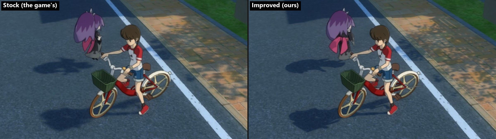

It is also lighter to run. The same busy street on the same laptop ([docs/baseline.md](docs/baseline.md),
2026-10-22), both at the game's own settings (1600×900, 30 frames/s, every improvement of this project off), so
the two do the same work:

| | Emulator (Eden) | This project |
|---|---|---|
| CPU | 210% of one core | 111% |
| Memory | 15.7 GB | 3.9 GB |
| GPU | 30% | 33% |

## Features

What the PC version adds to the Switch game. Open an entry for details, pictures and measurements; more in [docs/graphics.md](docs/graphics.md).

**Graphics**

<b>Resolution</b>: up to 4K, menus and text at the same size

The 3D world at 1600×900 (the Switch's), 1920×1080, 2560×1440 or 3840×2160; the menus and text are drawn at the same size on top. About 30 frames/s at 4K on an RTX 4070 laptop without upscaling; with upscaling (under Performance) well above.

<b>Aspect ratio</b>: 16:10, 21:9 and 32:9, the UI kept 16:9 in the middle

16:9 (the Switch's), 16:10, 21:9 and 32:9. Below, 21:9 in the schoolyard: the world goes on at
the sides; the minimap and button hints stay where they are on the Switch.

Exploring, cutscenes and battles all work at the wider ratios. 21:9 at 4K height (5120×2160), from play:

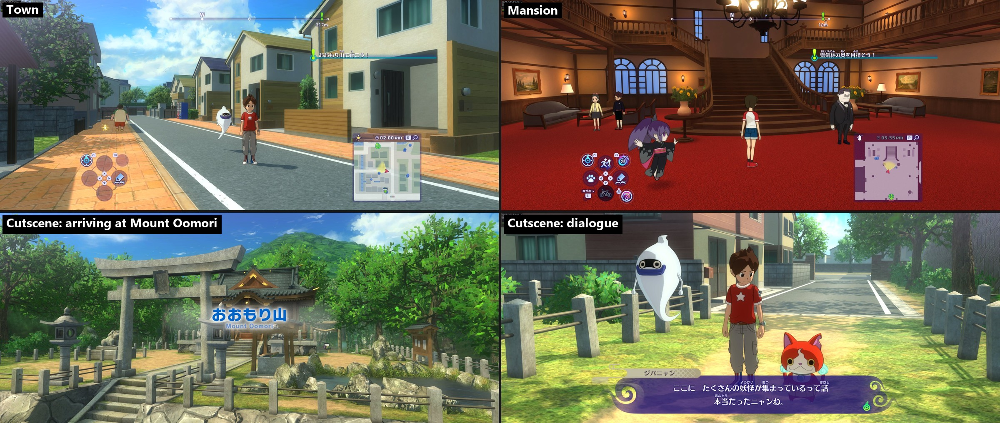

Layers over the whole screen, like the dimming behind a dialog and the loading screen's black, cover the full
width; pictures made for 16:9 (the copyright notice, movies, the dungeon map's backdrop) stay 16:9 in the middle
with black bars, and the town's fast-travel map shows more of the town at the sides. At 4K ultrawide there are
occasional stutters in heavy scenes; more optimization is planned ([known issues](docs/known-issues.md)).

Menus, maps and battles at 21:9 (the dialog at 2133×900, the rest at 5120×2160):

![Yo-kai Pad: 21:9 Yo-kai Pad menu; Fast-travel map: more of the town at the sides: 21:9 town fast-travel map reaching the edges; Dungeon map: a 16:9 picture with black bars: 21:9 bamboo forest map with black side bars; Dialog: the dimming covers the full width: 21:9 dialog with the whole screen dimmed; Into a battle: 21:9 swirl into a battle; Battle start: 21:9 battle start with the enemy yo-kai; Battle: 21:9 battle with the command wheel; Battle results: 21:9 battle results over the blurred field](docs/screenshots/84-ultrawide-menus-battles.jpg)

<b>Shadow map size</b>: up to 4096, for sharper shadow edges

A bigger shadow map gives sharper, more detailed shadow edges, most visibly on shadows far from
the camera. The bamboo forest, PCSS off:

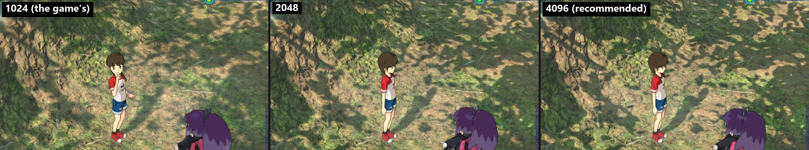

<b>Soft shadows (PCSS)</b>: sharp where a shadow touches its caster, softer farther away

PCSS (percentage-closer soft shadows) makes shadows behave more like real ones:

- **Close shadows stay sharp**: where a shadow touches its caster (feet, poles, the base of a wall).
- **Farther shadows get softer**: the farther the caster is from the ground, the softer the edge, so tree canopies
  become soft dappled shade instead of a field of hard dots.
- **Less shimmering**: hard edges flicker as the camera moves; softer ones spread that out, so distant shadows
  shimmer much less.

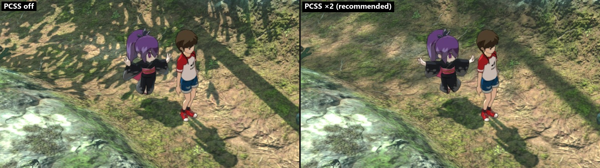

<b>Anti-aliasing</b>: FXAA, SMAA and TAA, with the UI kept sharp

The Switch version has none. Three kinds are in, all applied to the 3D scene before the UI is
drawn, so text and menus stay sharp:

- **FXAA**: fast, smooths jagged edges in one frame.
- **SMAA**: sharper edge smoothing than FXAA, also one frame at a time.
- **TAA**: also fixes shimmer. Thin things (fences, the goal net, wires, leaves) fall between pixels differently
  every frame, so they crawl while the camera moves. TAA shifts the 3D scene by a fraction of a pixel each frame and
  blends the frames together, using the motion the game already writes for every pixel. In the schoolyard the goal
  net breaks into dots and dashes without AA; with TAA it is a continuous mesh. A light sharpen keeps textures crisp
  ([decision 0032](docs/decisions/0032-taa.md)).

Yo-kai World with TAA, 21:9 at 4K height (5120×2160):

The same frame zoomed in 3×: the red railing, the fence by the lamp post and the road line.

<b>Texture filtering</b>: anisotropic up to ×16, sharp ground into the distance

The Switch version uses none, so the ground blurs a short way ahead of the camera. Anisotropic
filtering keeps the road, pavement and walls sharp into the distance, even at a low angle. Yo-kai World with ×16:

The same spot zoomed in 2×: the crosswalk far ahead, the pavement on the right and the road surface.

**Performance**

<b>Frame rate</b>: 30, 60, 120, 144 or no limit, switchable while playing

FRAME RATE in the settings panel: the game's 30 frames/s, or 60, 120, 144 or no limit. The game already moves by the real time between frames, so walking and battles keep their speed at any rate (~140 frames/s at 1600×900). Menus and cutscenes are still being checked. At 4K the GPU is the limit: upscaling lifts it, frame generation doubles what is shown.

<b>Upscaling (NVIDIA DLSS, AMD FSR)</b>: the world drawn smaller, rebuilt at full size, menus kept sharp

With ANTI-ALIASING set to DLSS or FSR, the UPSCALING row draws the 3D world smaller than the resolution and the
upscaler rebuilds a full-size picture from it and the frames before, using the motion the game writes. The menus
and text are drawn afterwards at full size.

**Which to use: on an NVIDIA RTX GPU, choose DLSS.** It is both sharper and cheaper than FSR here: more frames in
every mode, and fine patterns (perforated fences, leaves) stay clean where FSR turns them to grain. Its DLSS MODEL
row picks FAST (the default, NVIDIA's older model: nearly as clean, about half the GPU time) or BEST (the newest).
**On other GPUs, use FSR** (DLSS needs NVIDIA RTX; choosing it elsewhere falls back to FSR).

Bamboo forest at 4K 21:9 on an RTX 4070 laptop. For comparison, without DLSS or FSR (native 5120×2160 with TAA):
**~59 frames/s**. With them, frames/s:

| Mode | World drawn at | DLSS (fast model) | FSR |
|---|---|---|---|
| native, UPSCALING off (DLSS / FSR as anti-aliasing only) | 5120×2160 | ~53 (DLAA) | ~46 |
| quality | 3413×1440 | **~81** | ~75 |
| balanced | 3013×1271 | **~93** | ~86 |
| performance | 2560×1080 | **~112** | ~104 |

DLSS's own work costs ~2.6 ms of GPU time per frame at this output size, FSR's 3.7-4.5 ms.

Each image below: on top the whole native frame with the cropped areas in yellow, underneath the 1:1 crops, each
labelled with its mode (DLSS: fast model).

Quality (the world drawn at 3413×1440): native, FSR, DLSS. The quest text is as sharp in all three (the UI is
drawn at full size); DLSS keeps the bamboo and the lantern closest to native.

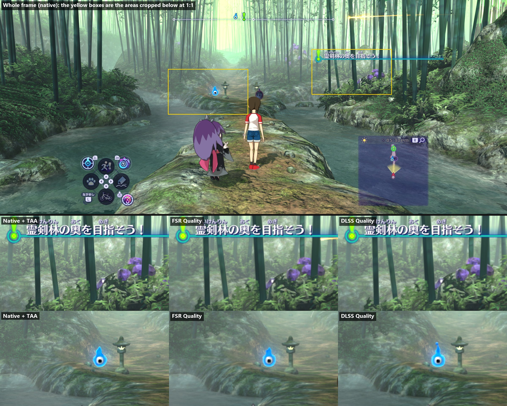

Performance (the world drawn at 2560×1080, a quarter of the pixels): native, FSR, DLSS. DLSS keeps the bamboo and
the leaves crisper.

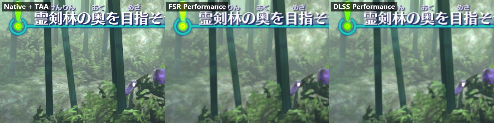

The schoolyard's perforated high fence at performance: native, FSR, DLSS. FSR turns the holes into grain, DLSS
keeps a clean pattern.

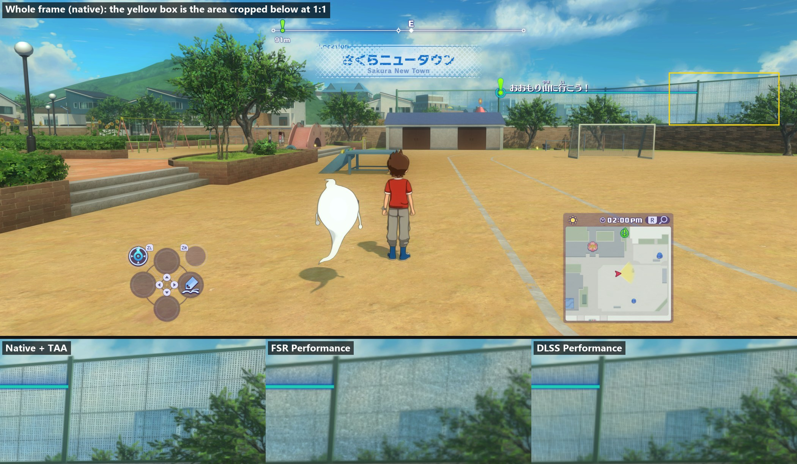

The schoolyard's far goal net at balanced (the world drawn at 3013×1271): native, FSR, DLSS. Both keep the net
at this mode; DLSS's mesh is the more even.

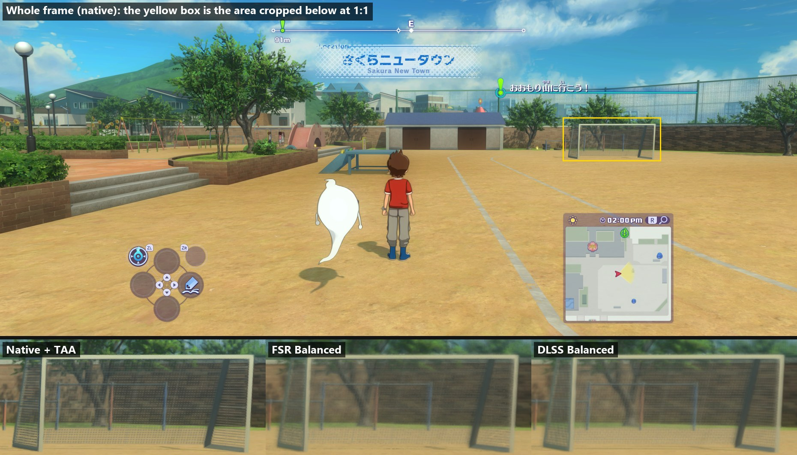

A running character at quality, then at performance: native, FSR, DLSS. No trail behind the moving leg in either.

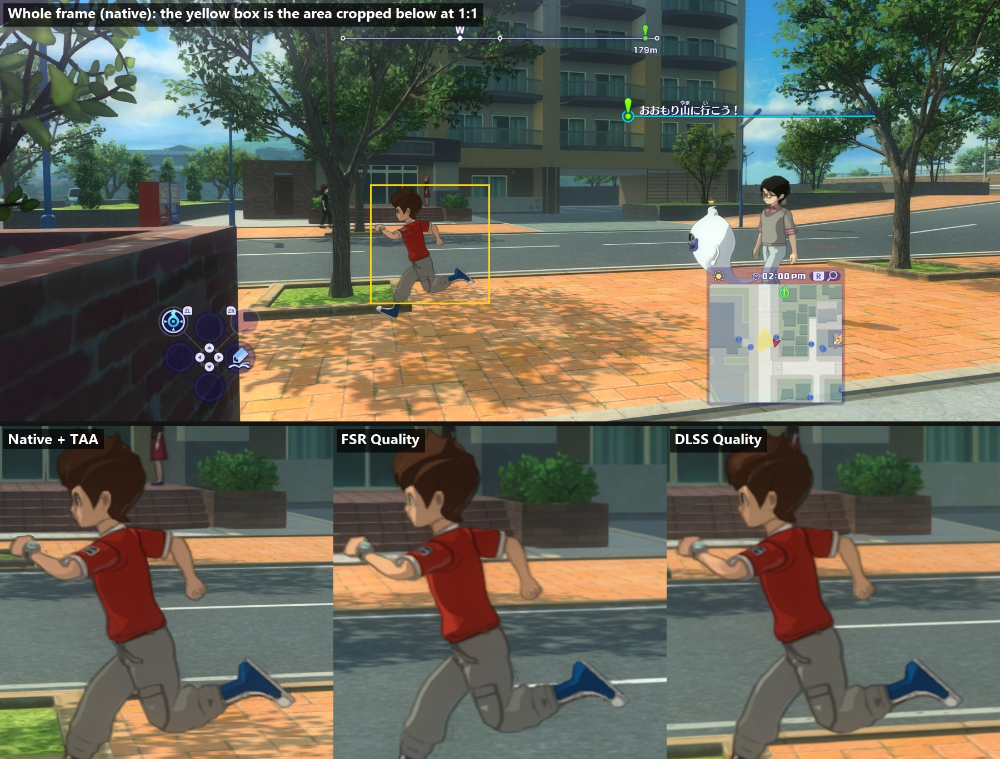

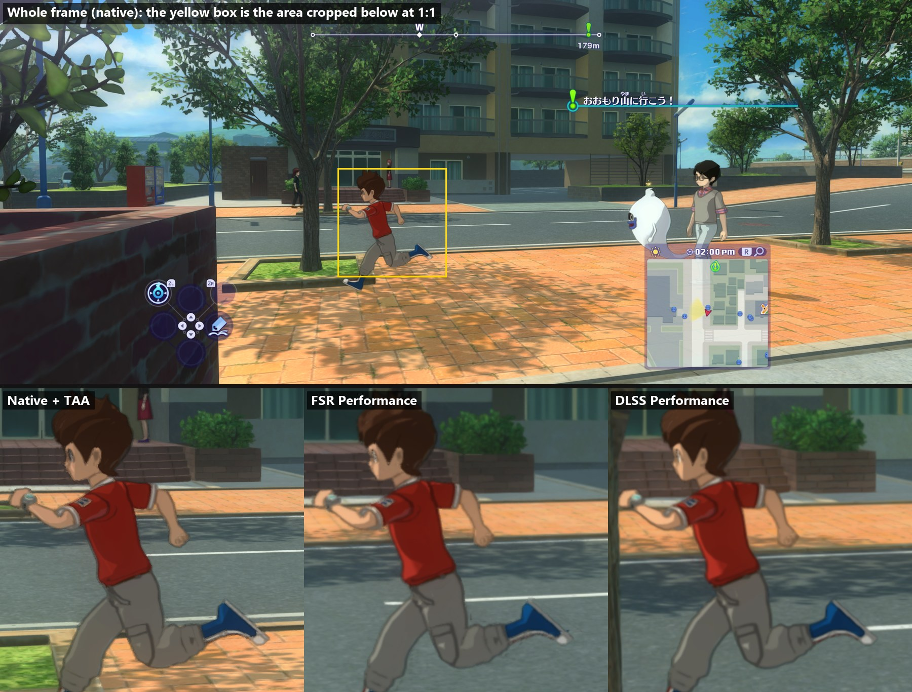

A whole frame in DLSS performance, the world drawn at 2560×1080 and shown at 5120×2160 (scaled down here), ~112
frames/s on the laptop:

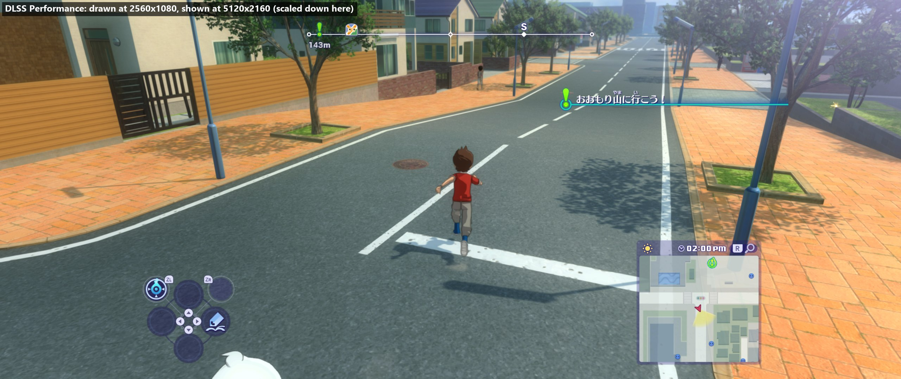

How they work and what was measured: [decisions 0039 (FSR)](docs/decisions/0039-fsr-upscaling.md) and
[0040 (DLSS)](docs/decisions/0040-dlss-upscaling.md).

NVIDIA DLSS is a technology of NVIDIA Corporation, used under NVIDIA's RTX SDK licence; its files are downloaded
by the build and are not part of this repository. AMD FSR is AMD's, under the MIT licence.

<b>Frame generation (NVIDIA DLSS, AMD FSR)</b>: a frame made between each two of the game's, the menus kept still

With ANTI-ALIASING set to TAA, FSR or DLSS, the FRAME GENERATION row makes one frame between each two the game
draws, from the motion the game writes and the depth, and shows it in between: about twice as many frames on screen.
It switches while playing. The menus, our HUD and the settings panel stay still and sharp: frame generation is given
the picture from before the menus are drawn, so it can tell them from the world.

**Which to use: on an NVIDIA RTX 40 or newer, choose DLSS.** It leaves the game more frames of its own and keeps
moving characters cleaner. **On other GPUs, use FSR** (DLSS frame generation needs RTX 40 or newer; the row skips it
elsewhere).

Busy late-game town at 4K 21:9 on an RTX 4070 laptop (DLSS performance upscaling, FRAME RATE unlimited). Without
frame generation: **~70 frames/s**. With it:

| Frame generation | Game frames/s | Frames on screen/s |
|---|---|---|
| off | ~70 | ~70 |
| FSR | ~63 | ~126 |
| DLSS | **~75** | **~150** |

The game draws fewer frames of its own with FSR because its frame generation runs on the same GPU (~7 ms per frame
at 5120×2160); DLSS's runs on the RTX's own hardware for it. The HUD (F3) shows both numbers: FPS counts the game's
frames, SHOWN the frames on screen.

Things to know:

- It adds about half a frame of input delay, so it feels best where the game already runs at 60 or more.
- FRAME RATE limits the game's own frames; what is shown is about twice that.
- DLSS frame generation pauses while the game window isn't the focused window (NVIDIA's rule).
- With DLSS frame generation, NVIDIA Reflex is on (NVIDIA requires it). The REFLEX row sets it otherwise: it lowers
  input delay most when the GPU limits the frame rate; where the CPU does, it costs some frames (~14% in a busy town).

FSR, Nate running across the schoolyard: the game's frame before, the frame FSR made, the game's frame after. The
minimap, clock and buttons stay sharp. Fast arms and legs, and Whisper's edge, come out blended in the made frame:
FSR's weak spot with thin things that move on their own (the thin dark line at the right edge is FSR's too).

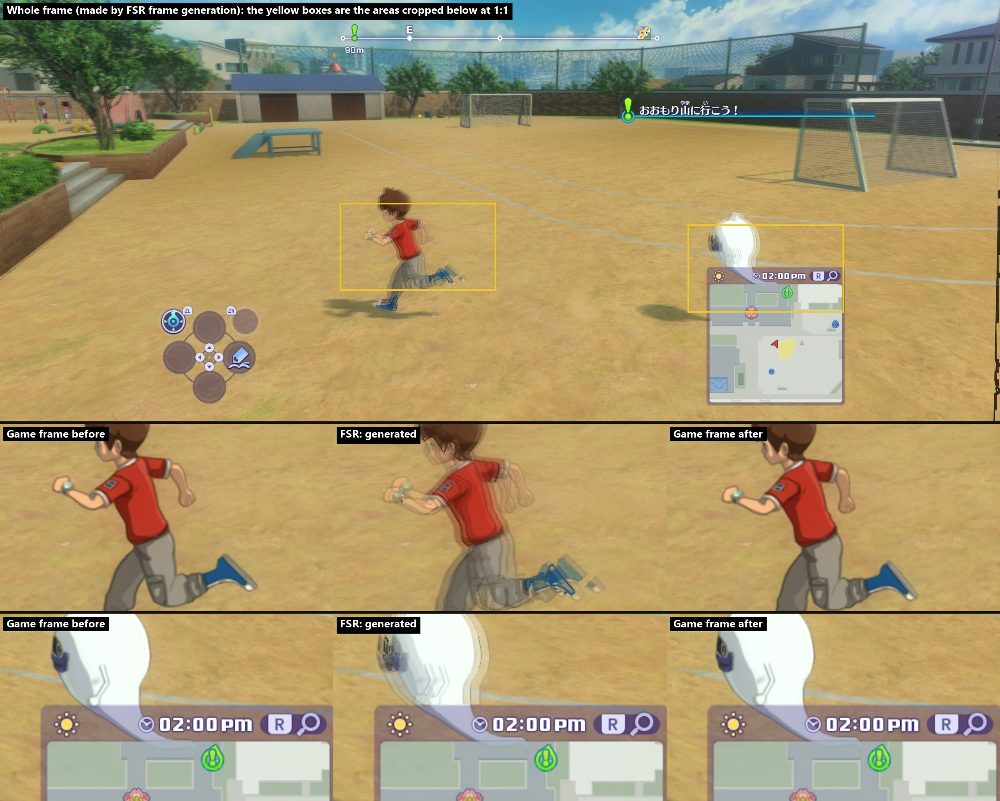

DLSS, by the school's windows: a frame DLSS made. DLSS makes its frames after ours are presented, so they can only
be captured from the screen (here a 3440×1369 window with only DLSS's frames shown); the crops are 1:1 of that
capture. The HUD, minimap and characters come out clean.

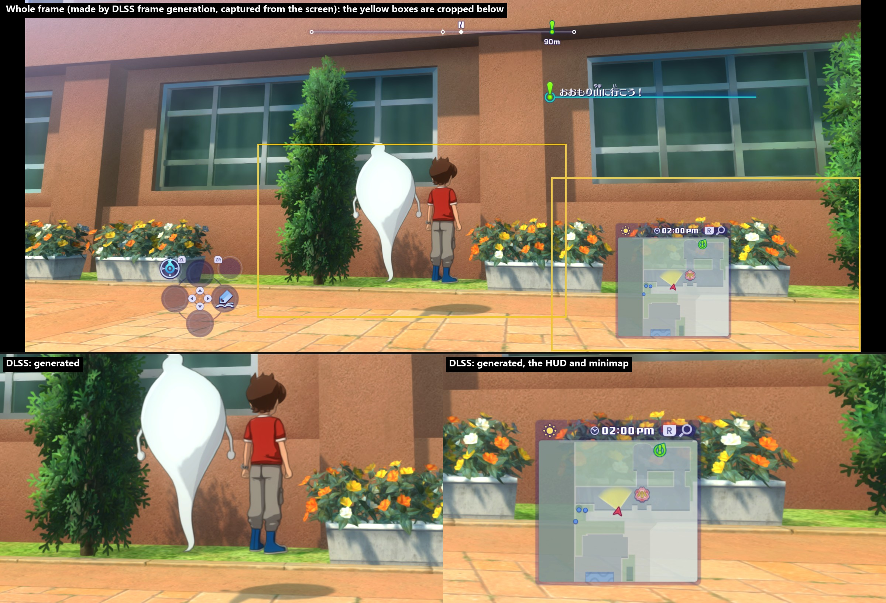

How they work and what was measured: [decision 0041](docs/decisions/0041-frame-generation.md).

NVIDIA DLSS Frame Generation, Reflex and Streamline are NVIDIA Corporation's (Streamline under the MIT licence, the
DLSS and Reflex files under NVIDIA's RTX SDK licence), downloaded by the build and not part of this repository. AMD
FSR is AMD's, under the MIT licence.

**Controls**

<b>Keyboard, mouse and controllers</b>: rebind everything, the mouse turns the camera

**Controls (F2)**, with a DualSense

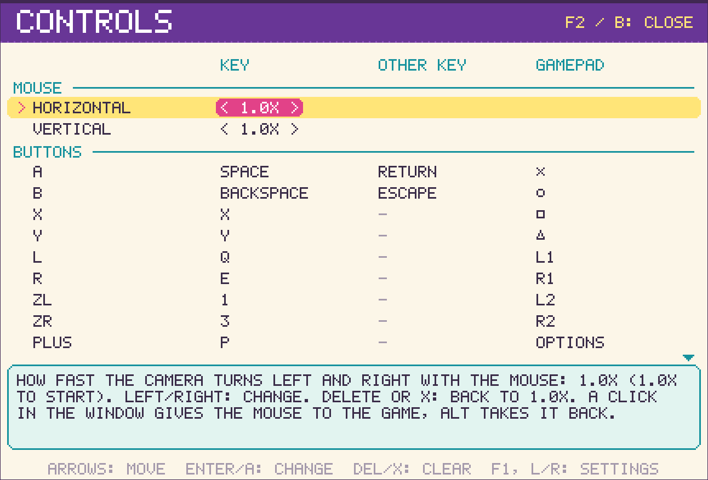

**Controllers:** Xbox, PlayStation and Joy-Cons work, and the controls page names the buttons as printed on
yours (A B X Y and LB/RT on Xbox; × ○ □ △ and L1-R3 on PlayStation; ZL/ZR on Nintendo). By default the game's
confirm is your controller's own confirm: × on a DualSense, A on Xbox. Tested by playing with a **DualSense (PS5)**,
battles included, and with the controls page.

**Mouse:** the game's code still has a mouse camera that the Switch version never feeds; we feed it, so the mouse
turns the camera. A click in the
window gives the mouse to the game, Alt or opening the panel gives it back. Mouse buttons and the wheel can be bound
on the CONTROLS page; none are by default.

<b>Button icons</b>: the keys or buttons you actually use, in the HUD and in text

**Button icons** in the HUD and in text follow what you last pressed, a key or a controller, and your bindings.
The game's files still hold keyboard, Xbox and PlayStation icon sets that the Switch version never shows; we
show those instead of the Switch buttons. Below, the shortcut wheel and the minimap's search button with each:

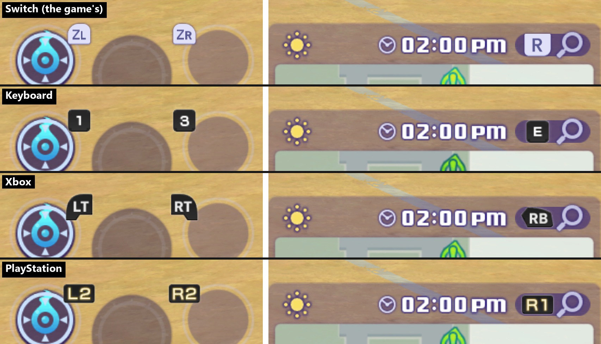

**Mods**

<b>Mods</b>: the English translation patch and other Switch mods, without touching your dump

Put a mod in `work/mods`, in the layout a modded Switch uses: `work/mods/contents/010086c00af7c000/<mod name>/romfs/...`
(or simply `work/mods/<mod name>/romfs/...`). At start its files replace the game's at the same paths and its new
files are added, as on a Switch; your dump is not changed. The log names each mod it loaded. `YW4_MODS` points to
another folder, `YW4_MODS=none` turns mods off. The fan **English translation patch** works this way (not included,
get yours from [GameBanana](https://gamebanana.com/mods/480884)):

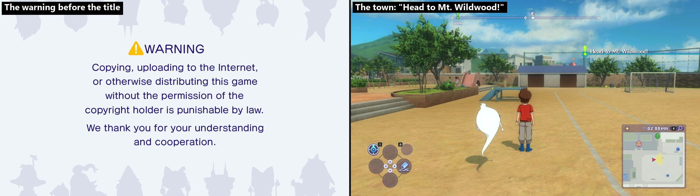

**Settings**

<b>Settings panel</b>: every option in game (F1), the controls on F2

Press **F1** in game for the settings panel: every option with all its choices, and what each one does (arrow keys or
D-pad to choose and change). Its last row, **DEVELOPER OPTIONS**, opens the switches players don't need: which parts
of the picture the game draws and which our own renderer does (the picture is the same), and speed-ups that look the
same. **F2** opens the **CONTROLS** page: two keys or mouse buttons and one gamepad button for every Switch
button and stick direction, changed by pressing the new one, and at the top the mouse's camera sensitivity, left-right and up-down. On a gamepad the DualSense's **mic button** (Share on
Xbox pads) opens the settings and **Create + Options** (Minus + Plus) the controls; L/R or the triggers switch
pages. The DualSense's **touchpad** shows the performance HUD (F3). Your choices are saved in
`settings.ini` next to `yw4.exe` and kept for the next start. Settings are only in the panel; the other function keys
are debugging tools ([docs/debugging.md](docs/debugging.md)).

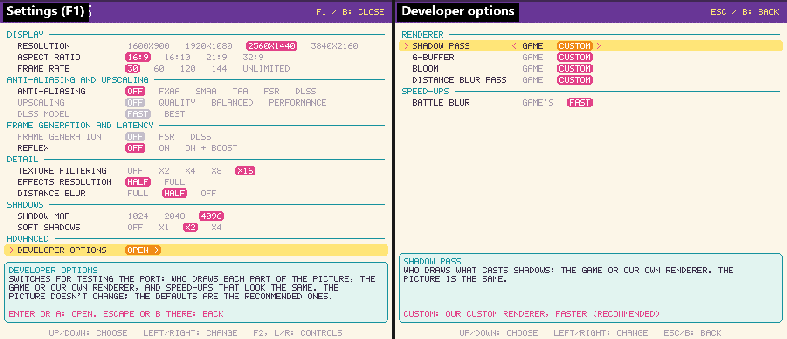

| Setting | What it does |
|---|---|
| **Display** | |
| Resolution | 1600×900 (the Switch's), 1920×1080, 2560×1440 or 3840×2160; the UI is drawn at the same size |
| Aspect ratio | 16:9 (the Switch's), 16:10, 21:9 or 32:9: the world shows more at the sides, the UI stays 16:9 in the middle |
| Frame rate | 30 (the Switch's), 60, 120, 144 or unlimited; the game keeps its speed at any rate |
| **Anti-aliasing and upscaling** | |
| Anti-aliasing | Off (default), FXAA, SMAA, TAA, FSR or DLSS, applied to the 3D scene before the UI is drawn, so text stays sharp. TAA, FSR and DLSS also steady thin things that shimmer: fences, nets, leaves |
| Upscaling | Off (default), quality, balanced or performance: the world drawn smaller and rebuilt at full size by FSR or DLSS. Needs anti-aliasing set to FSR or DLSS |
| DLSS model | Fast (default, the older model) or best (the newest, more GPU time) |
| **Frame generation and latency** | |
| Frame generation | Off (default), FSR (any GPU) or DLSS (NVIDIA RTX 40 and newer): a frame made between each two of the game's, about twice as many on screen. Needs anti-aliasing set to TAA, FSR or DLSS |
| Reflex | NVIDIA GPUs: off (default), on or on + boost: less input delay, most where the GPU limits the frame rate. On while frame generation is DLSS |
| **Detail** | |
| Texture filtering | Off (the Switch's) or anisotropic ×2 to ×16: distant and slanted ground, roads and walls stay sharp. Default ×16 |
| Effects resolution | Half (the Switch's) or full: the shadow mask, lamp lights and ambient occlusion at the 3D view's size, for sharper shadow edges. Costs ~2 ms of GPU at 1600×900 |
| Distance blur | Full (the Switch's), half or off: the game blurs everything far away. Default half |
| **Shadows** | |
| Shadow map | 1024 (the Switch's), 2048 or 4096: sharper shadow edges. Default 4096 |
| Soft shadows (PCSS) | Off (the Switch's), ×1, ×2, ×4. Default ×2 |
| **Developer options** | |
| Shadow pass, G-buffer, bloom, distance blur pass | The game's renderer or ours draws that part of the picture; the same picture. Ours by default |
| Battle blur | The game's or fast (default): the blur as a battle starts with a quarter of the rounds, the same look, ~3 ms less GPU time |

F3 shows a performance HUD in the window's corner: frame time, CPU and GPU cost and memory; with frame generation on,
also the frames on screen (SHOWN).

The game starts at the Switch's 1600×900 and 16:9 with a 4096 shadow map, PCSS ×2, ×16 texture filtering, half
distance blur, half-size effects and no anti-aliasing. For the game's original look, set every setting to its first choice in the
panel.

## Screenshots

All captured from the recompiled build on Windows.

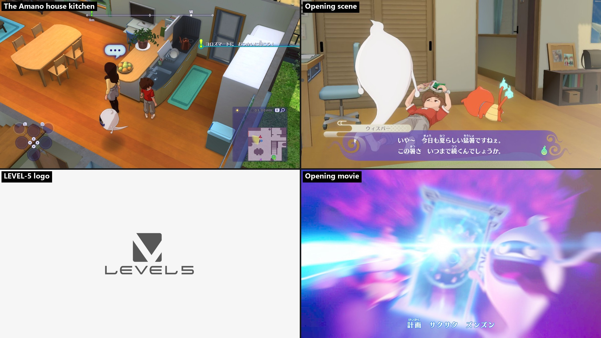

In town with the performance HUD on (F3). The game is a native Windows program: the frame takes about 10 ms of
work on the CPU and under one core of a 16-core laptop, against the 33 ms the game's 30 frames/s allow; the
shadows here are our own pass with no graphical improvements applied (SHADOW PASS: CUSTOM in the panel).

  

## Goals

<b>Planned</b> (1)

| Goal | Where it stands |
|---|---|
| **Linux** | The runtime is written to be portable; not built or tested there yet |

<b>Ongoing</b> (5)

| Goal | Where it stands |
|---|---|
| **Our own renderer** | Replace the game's renderer pass by pass: the base for the graphics features above; shadows, surfaces, bloom and distance blur are ours already |
| **Better shadows** | Bigger shadow maps and PCSS soft shadows done; contact shadows and steadier cascades next |
| **Higher frame rates** | 30, 60, 120, 144 or no limit, switchable while playing (FRAME RATE in the panel): the game already moves by the real time between frames, so walking and battles keep their speed (~140 frames/s at 1600×900). At 4K the GPU is the limit; upscaling lifts it, frame generation doubles what is shown. Menus and cutscenes are being checked |
| **Better anti-aliasing** | FXAA, SMAA and now TAA (steady thin edges: fences, nets, leaves) on the 3D scene before the UI is drawn, so text stays crisp; per-object motion for TAA next |
| **Keyboard, mouse and controllers** | Bindings on the panel's CONTROLS page, saved, with your controller's own button names; tested with a DualSense. On-screen button icons follow what you play with and your bindings (keyboard, Xbox, PlayStation or Nintendo, [decision 0042](docs/decisions/0042-button-icons-and-mouse.md)). The mouse turns the camera through the game's own unused mouse code; being tested |

<b>Finished</b> (7)

| Goal | Where it stands |
|---|---|
| **Performance** | The game's 30 frames/s everywhere tested, and well above it with the FRAME RATE setting (60, 120, 144 or no limit) |
| **Sharper distance** | Anisotropic texture filtering and a softer distance blur: distant ground, roads and buildings stay sharp without 4K |
| **Higher resolution** | The 3D view at 1080p, 1440p or 4K instead of the game's 1600×900 (30 frames/s at 4K on an RTX 4070 laptop) |
| **Ultrawide and other aspect ratios** | 16:10, 21:9 and 32:9 in the panel: a wider view of the world with the UI kept 16:9 in the middle; exploring, battles and cutscenes work; dialog dimming and the loading screen cover the full width |
| **Upscaling (NVIDIA DLSS, AMD FSR)** | The world drawn smaller and rebuilt at full size, menus and text kept full size. **On NVIDIA RTX GPUs use DLSS: sharper and cheaper than FSR.** At 4K 21:9 on an RTX 4070 laptop, instead of ~59 frames/s: DLSS ~81 / ~93 / ~112 (quality / balanced / performance), FSR ~75 / ~86 / ~104 (any GPU). DLSS keeps fine patterns (far nets, perforated fences) clean where FSR gets grainy ([decisions 0039](docs/decisions/0039-fsr-upscaling.md), [0040](docs/decisions/0040-dlss-upscaling.md)) |
| **Frame generation (NVIDIA DLSS, AMD FSR)** | A frame made between each two of the game's: about twice as many on screen, the menus kept still. **On RTX 40 and newer use DLSS**: more game frames left and cleaner moving characters. In a busy town at 4K 21:9 on an RTX 4070 laptop, instead of ~70 frames/s: DLSS ~150 shown (~75 game), FSR ~126 shown (~63 game, any GPU). NVIDIA Reflex in the panel too ([decision 0041](docs/decisions/0041-frame-generation.md)) |
| **Mod support** | Mods in the Switch's layout are laid over your game files at start, as on a modded Switch, without touching your dump: the English translation patch runs (see [Features](#features), [decision 0043](docs/decisions/0043-mods-layeredfs.md)) |

## Behind the scenes

- **Translated ahead of time, not interpreted.** Every ARM64 function in the game's `main` and `sdk` modules (73,844
  functions) becomes C before the game runs ([recomp/](recomp/README.md)); Clang compiles it into one native program.
- A native runtime ([runtime/](runtime/)) stands in for the Switch: the kernel (threads, memory, synchronisation),
  system services (filesystem with your RomFS read in place, input, audio, time, saves, applets) and the NVN graphics
  API on top of Vulkan.
- The game's own shaders are translated from the NV_gpu_program5 assembly they ship with into GLSL and SPIR-V
  ([decision 0020](docs/decisions/0020-shaders-from-the-assembly.md)).
- No emulator code is linked ([decision 0005](docs/decisions/0005-phase1-runtime-strategy.md)). Each instruction form
  of the recompiler is checked against a real ARM64 CPU (a Raspberry Pi 5).
- Why things are built this way is written down in [docs/decisions/](docs/decisions/).

## Building from source

Requirements: Python 3.11+, Git, a C compiler (Clang recommended:
[llvm-mingw](https://github.com/mstorsjo/llvm-mingw) on Windows; GCC also works), a GPU with Vulkan 1.3, and
`glslangValidator` (from the [Vulkan SDK](https://vulkan.lunarg.com/), or a standalone glslang). SDL3 is fetched
automatically on Windows. Full steps in [docs/setup.md](docs/setup.md).

1. If you will commit: install the guard that keeps game data out of commits, `python -m tools.yw4.guard --install`.
2. Copy `config.example.toml` to `config.local.toml`. Point `exefs_dir` and `romfs_dir` at your extracted ExeFS and
   RomFS; set `[tools] cc` to your Clang (the default is gcc) and `[tools] glslang` if it isn't on your PATH.
3. Check the config: `python tools/yw4/config.py` prints the resolved paths or says what is missing.
4. Verify and decompress the game code: `python -m tools.yw4.ingest`.
5. Recompile and build: `python -m recomp.translate`, `python -m tools.yw4.shaders`, `python -m recomp.shader --check`,
   then `python -m recomp.build --run`.

Runtime options are environment variables, for example `YW4_SHADOW_RES=1024`: in PowerShell
`$env:YW4_SHADOW_RES = "1024"`, in cmd `set YW4_SHADOW_RES=1024`, before starting the game.

Runtime options, capture keys, input replay and the frame-inspection tools are in
[docs/debugging.md](docs/debugging.md).

## Project layout

| Path | What |
|---|---|
| `recomp/` | AArch64 → C recompiler and the shader translator |
| `runtime/` | Native runtime: kernel, services, NVN on Vulkan |
| `tools/` | Python input pipeline and analysis tools |
| `tests/` | Tests on synthetic data (no game files) |
| `docs/` | Setup, debugging, graphics options, progress, known issues, decision records, recon report, Eden baseline |
| `third_party/musl/` | musl 1.1.19's math functions (MIT) |
| `third_party/smaa/` | SMAA's shader and lookup textures (MIT) |
| `work/`, `build/` | Generated output from your own game files (gitignored, never committed) |

## Credits

- **[N64Recomp](https://github.com/N64Recomp/N64Recomp)** - the model this project follows: ship the tools, let
  every player recompile their own copy.
- **[LAS Recomp](https://github.com/peiikai/LASRecomp)** by peiikai - a static recompilation of *Link's Awakening*
  for Switch; its approach to the Switch SDK and its README layout inspired this project's.
- **[musl](https://musl.libc.org/)** - the math library (`third_party/musl`, MIT).
- **[SMAA](https://github.com/iryoku/smaa)** by Jorge Jimenez et al. - the SMAA anti-aliasing shader and lookup textures (`third_party/smaa`, MIT).
- **[SDL3](https://www.libsdl.org/)** and the **[Vulkan](https://www.vulkan.org/)** headers.
- **Eden** (a Switch emulator) - used only as a visual and performance reference; none of its code is used.
- **LEVEL-5** for Yo-kai Watch 4. This project is not affiliated with or endorsed by LEVEL-5 or Nintendo.

## License

[MIT](LICENSE), for the code and docs in this repository only: not the game, its files, or anything built from
your copy of it. Third-party code keeps its own license (`third_party/musl`, `third_party/smaa`: MIT).
