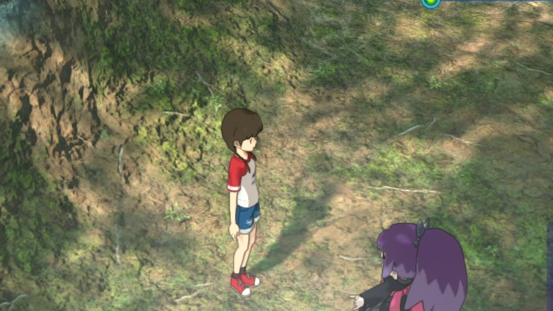
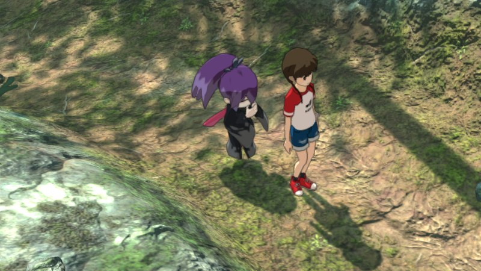
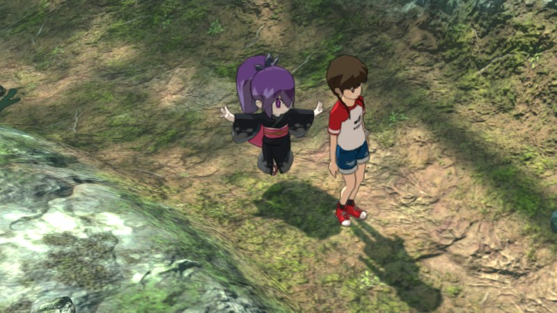

# Graphics options in detail

The options in the [README](../README.md#graphics-options), with the comparisons and measurements behind them. Keys
work while playing; the environment variables set them at start ([debugging.md](debugging.md)).

## Native shadow pass (panel: SHADOW PASS)

Our own renderer draws the shadow casters the game would draw, from the game's data, instead of replaying the game's
draw calls one by one ([decision 0024](decisions/0024-shadow-pass.md)). It covers static, cut-out, skinned and
instanced casters, including props fading in and out and wind-swayed plants; the game still draws the rest (a second
kind of character, a few others).

The shadow pass is the first step, not the end point: the plan is to **replace the game's whole renderer with our
own**, one pass at a time ([the goals](../README.md#our-own-renderer)). Replaying the game's draw calls ties
every frame to the Switch's choices: its resolution, its 16:9 layout, its shadow map size and filters. A renderer of
our own draws the same scene from the game's data, so those choices become ours to change.

Same save and frame, the game's shadows against ours. The only differences are animation timing between the two
runs (Whisper's float, idle poses, leaves):

| The game's shadows | Our shadow pass |
|---|---|
|  |  |

Difference image (white: pixels that differ)

Cost per frame on a scripted walk through the town (average of 3 runs each, alternating, nothing else running;
RTX 4070 Laptop):

| Per frame | The game's shadows | Our shadow pass | Change |
|---|---|---|---|
| Game work, average | 10.9 ms | 10.3 ms | **−0.6 ms** |
| Game work, 95th percentile | 18.0 ms | 16.8 ms | **−1.2 ms** |
| GPU busy, average | 11.3 ms | 10.9 ms | −0.3 ms |
| Process CPU | 72.7% of a core | 71.3% of a core | −1.4 points |

## Shadow map size (panel: SHADOW MAP)

1024 (the game's), 2048 or 4096. Bigger maps give sharper edges, mostly in the far cascades. Recommended: 4096.

The bamboo forest with PCSS off at each size, and 2048 with PCSS ×1 added:

| 1024 (the game's) | 2048 |
|---|---|
|  |  |
| **4096** | **2048 + PCSS ×1** |
|  |  |

## PCSS, soft shadows (panel: SOFT SHADOWS)

Off, ×1, ×2, ×4. PCSS (percentage-closer soft shadows) makes shadows behave more like real ones:

- **Close shadows stay sharp.** Where a shadow touches the thing casting it (feet, poles, the base of a wall), the
  edge stays crisp.
- **Farther shadows get softer.** The farther the caster is from the surface the shadow falls on, the softer its
  edge, so tree canopies become soft dappled shade instead of a field of hard dots.
- **Less shimmering.** Hard shadow edges flicker and crawl as the camera moves, because each edge snaps to the
  shadow map's texels. Softer edges spread that over more pixels, so distant shadows shimmer much less.

It is added to the game's screen-space shadow mask shader only, so loading is as fast as before
([decision 0025](decisions/0025-pcss-soft-shadows.md)).

Another spot in the bamboo forest, 4096 map, PCSS off and its three strengths:

| PCSS off | PCSS ×1 |
|---|---|
|  |  |
| **PCSS ×2 (recommended)** | **PCSS ×4** |
|  |  |

**Recommended: 4096 map with PCSS ×2** (also what the game starts with): sharp contact shadows and soft, clean canopy
shade. For the game's original shadows, start with `YW4_SHADOW_RES=1024 YW4_PCSS=0` (or set SHADOW MAP to 1024 and SOFT SHADOWS to OFF in the panel).

## Our G-buffer and material passes (panel: G-BUFFER)

The G-buffer and the lit material pass draw with our own draw calls and, for most surfaces, our own shaders
(`runtime/shaders/`), with `YW4_GBUFFER=native`; the panel's G-BUFFER switches back to the game's
([decision 0026](decisions/0026-gbuffer-pass.md)). They look exactly like the game's: compared pixel by pixel
within the same frame, 0 pixels differ. There is nothing to see yet; this is the base the resolution, aspect ratio
and lighting work builds on.
